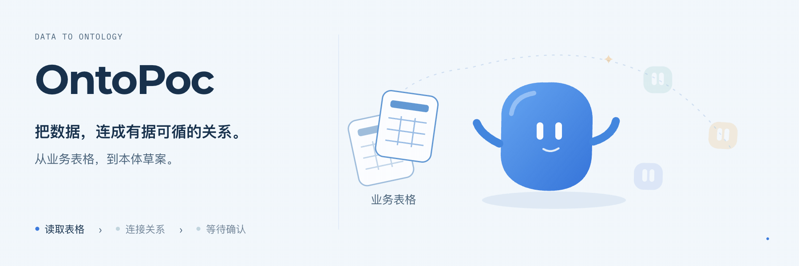
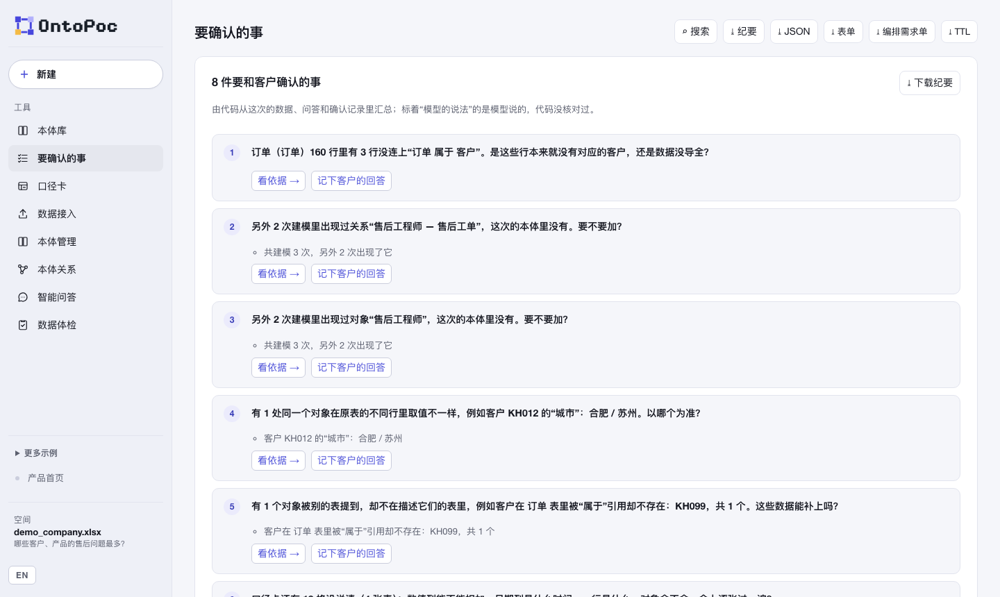
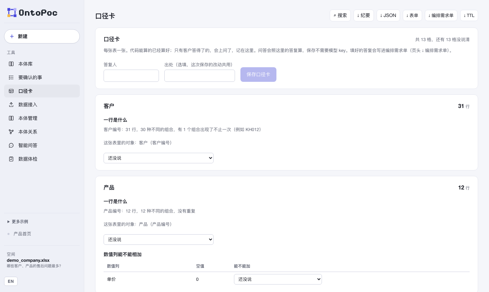
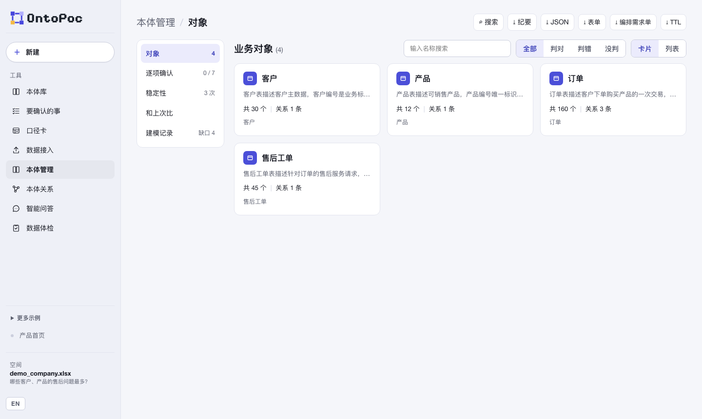
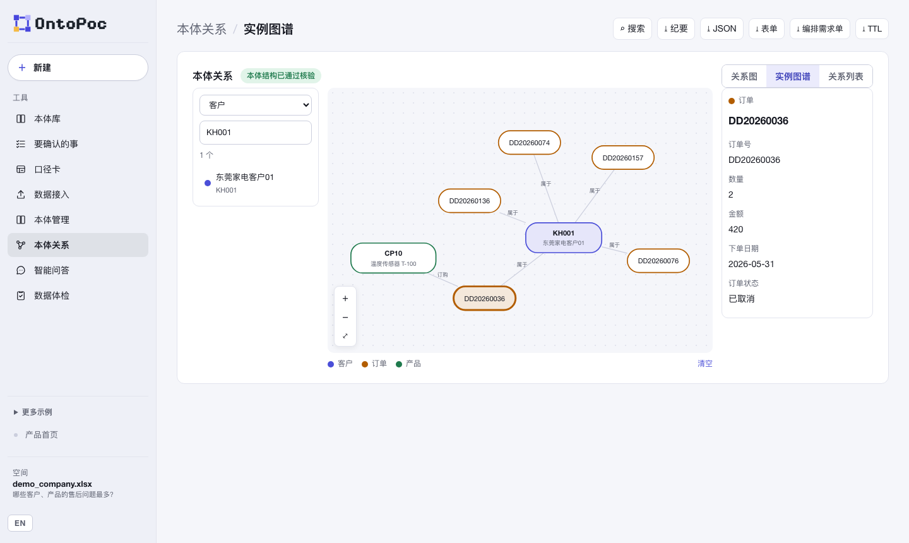
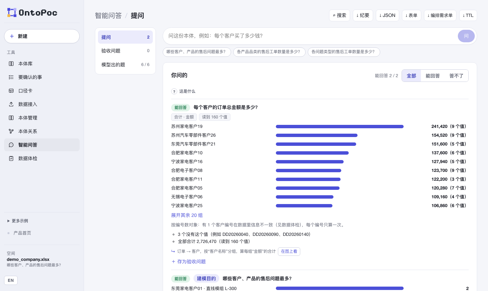
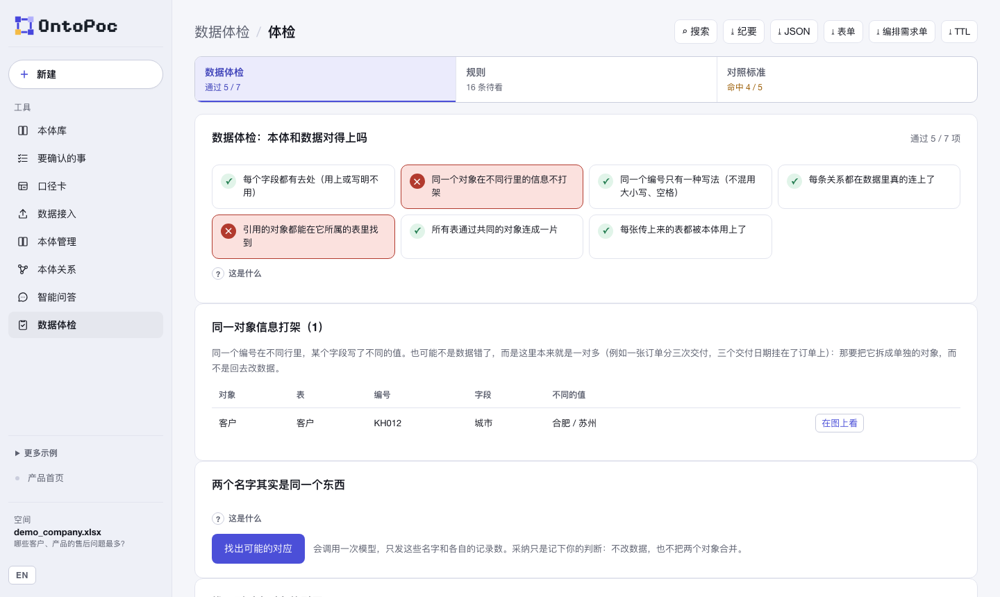

<p align="center">
  <picture>
    <source media="(prefers-color-scheme: dark)" srcset="landing-page/public/assets/ontopoc-logo.png">
    
  </picture>
</p>

<h1 align="center">OntoPoc</h1>
<p align="center"><strong>Generates a draft ontology from business data, with verifiable evidence for every element.</strong></p>
<p align="center">For data platform implementation consultants mapping the business objects and relationships in a client's data for the first time.</p>

<p align="center">
  <a href="LICENSE"></a>
  
  
  
  
</p>

<p align="center">
  <a href="README.md">中文</a> ·
  <a href="#quick-start">Quick start</a> ·
  <a href="#try-it">Try it</a> ·
  <a href="#contributing">Contributing</a>
</p>

<p align="center">
  
</p>
<p align="center"><sub>Concept illustration · <a href="docs/media/ontopoc-poster.png">Still image</a> · <a href="docs/media/ontopoc-motion.mp4">MP4</a></sub></p>

A common approach is to let a language model generate the ontology directly, which leaves its correctness hard to judge. OntoPoc restricts the model to proposing: every element is verified by code against every row, then confirmed by a person.

**Your files stay on your machine** · **All figures are computed by code** · **Source data is never modified**

The workbench interface is in Chinese only; the landing page has an English version. This page describes the workbench in English and gives the Chinese label in parentheses the first time it names a screen, tab or button.

## Overview

Upload a few business tables (Excel, CSV) or a process document, and OntoPoc drafts an ontology: which objects the business has, what tells each one apart, and how they relate. Code then checks it against every row: do the fields exist, do the identity fields have values, do the relations actually connect in the data. It runs data quality checks and answers business questions from the data. A document can also be read as an organisation: units, roles, people and work steps, and who belongs to, works with or hands over to whom, each item with a quote from the text. You judge each part right or wrong; your judgement is kept, and the next upload of the same file, or a new version of it, is compared against it.

Some things the data cannot settle and only the client can. Code gathers them into one list, Items to confirm (要确认的事), each with its basis and a sentence you can ask the client directly. Each table also gets a definition card (口径卡) that says what one row is, what time a date refers to, and whether a number can be added up. You record the client's answers in the meeting, and the questions are then computed with those answers.

The result can be exported in the shape of a data platform's object form; as a pipeline requirements sheet (编排需求单) for whoever builds the data pipeline, and a one-page meeting note; or as W3C Turtle (OWL and SHACL). The main features are also MCP tools other agents can call.

> **Early version.** Everything has been checked on public and synthetic data only (US federal procurement, Chicago city contracts, Northwind, BART transit, the Taiwan company registry, CMS hospitals and more). Nobody but the author has yet used it end to end on their own. The page has been used on macOS only. Batch import has not been tested on any data platform. See [Known issues](#known-issues).

## Screenshots

<p align="center"></p>
<p align="center"><sub>Items to confirm (要确认的事): 8 items on the sample workbook, each with its basis and a sentence you can ask the client; click "记下客户的回答" in the meeting.</sub></p>

<p align="center"></p>
<p align="center"><sub>Definition cards (口径卡): code has already worked out which columns tell each table's rows apart; what one row is and whether a number can be added up are left for the client.</sub></p>

<p align="center"></p>
<p align="center"><sub>Ontology (本体管理): the 4 business objects built from the sample workbook; on the left, item-by-item confirmation, stability, last-run comparison and build record.</sub></p>

<p align="center"></p>
<p align="center"><sub>Instance graph (实例图谱): customer KH001 opened out to its orders, and one order to its product; on the right, the selected order's raw fields.</sub></p>

<p align="center"></p>
<p align="center"><sub>Questions (智能问答): the model writes the question as a query; code computes the numbers on the uploaded data and says how many values it read.</sub></p>

<p align="center"></p>
<p align="center"><sub>Data check (数据体检): 5 of 7 checks pass; the 2 that fail are the problems planted in the sample, with the objects involved listed below.</sub></p>

All screenshots come from the synthetic sample in the repository, `examples/company/demo_company.xlsx`, rendered off-screen by a headless browser.

## How it works

| Action | What the system does |
|---|---|
| Open the ontology library (本体库) in the left sidebar | Search and browse 12 Playground reference ontologies by domain, and see objects, properties and relations on a graph. You can also import `.rdf/.owl` files in RDF/XML format. This is for reading definitions only: import calls no model, and you must pick the file again after a refresh |
| Upload tables and write the question you want answered | Code first counts every row: how many distinct values each column has, which columns differ on every row, which columns point into another table. The model sees each column's name, up to 3 example values and these counts, and proposes objects, identity fields and relations; code checks 14 kinds of error and sends it back to redo, up to 3 rounds |
| Wait for the build | Builds the same file 3 times at once and marks where the 3 disagree (where the model is unsure and you should decide); if your purpose asks a question, it is answered from the data too, ready to keep as an acceptance question |
| Open Items to confirm (要确认的事) | Code gathers what to confirm with the client from the data, the questions and the confirmation record, for example rows whose relations do not connect, objects with the same name but different numbers, and filters the model added by itself in a question. Each item has its basis and a sentence you can ask the client directly. In the meeting, click "记下客户的回答" (record the client's answer); the answers are saved with the run |
| Open Definition cards (口径卡) | One per table: what one row is, what time a date column refers to, whether a numeric column can be added up. Code fills in what it can work out; only the cells the client can answer are left for the meeting. The answers you fill in are used when questions are computed, and are written into the pipeline requirements sheet |
| Open the data check (数据体检) | Code computes 7 checks row by row, e.g. whether one number carries conflicting details, whether every uploaded table is used |
| Ask a question (智能问答) | The model writes a structured query and code computes the answer on the data; when it cannot, it says whether the ontology lacks something, the data lacks it, or the question is beyond the query. An amount that needs a formula (unit price × quantity × (1 − discount)) is proposed by the model, tried by code on every row, and once you confirm it the question is recomputed and answered. If an answer carries a filter the model added by itself, the filter is listed separately and you can drop it and recompute. The model can also write a round of 6 questions on request |
| Look at a relation's binding | Shows the source table and the two end ID columns, e.g. `EmployeeId → ReportsTo`. An endpoint reference connects only to objects that exist and never writes a subordinate's attributes onto the superior. When verification fails, it shows where, why and what to change |
| Judge each part, rename, add what is missing | Saved as this file's reference ontology; the next upload is compared against it and prefilled |
| Fix up to 3 questions as acceptance questions | Every rerun computes them with the same query and tells you which changed |
| Adopt rules found in the data | Every rerun checks them and lists the objects that break them |
| Mark an uploaded file as a new version (新版本) | Last time's confirmations (including what you judged wrong), acceptance questions and rules carry over, with how many of each object came and went. An object the model proposes again after you judged it wrong is flagged on its own |
| Draft the object form | One model call drafts Chinese names, descriptions and display fields; what you edited is never overwritten by a redraft |
| Export the object forms: click "⤓ 表单" at the top right | One CSV per object, in the columns data platforms usually ask for when defining an object |
| Click "⤓ TTL" at the top right | Three Turtle files: `ontology.ttl` describes objects, fields, relations and identity fields in OWL; in `data.ttl` every object is named by its identity values, so the same object in two tables or two versions of a file has one name and merges; `shapes.ttl` writes adopted rules as SHACL for any validator. What you judged wrong is left out |
| Click "⤓ 编排需求单" (pipeline requirements sheet) at the top right | Downloads a zip (one Markdown file and one JSON file) for whoever builds the data pipeline: the requirements that the data check, the items to confirm, the definition card answers, the confirmed metrics and the adopted rules place on data preparation. Each line states its source (found in the data by code, the client's answer, or a person's confirmation). It calls no model and changes no data |
| Click "⤓ 纪要" (meeting note) at the top right, or press ⌘K | Meeting note: one page of Markdown with the items to confirm first, for use in the meeting. ⌘K: search the objects, fields, relations and tables of this run and jump to where they are |

The model only judges; loops and calculations are in code, with model calls chained at most 3 deep and each call tied to a judgement a person has to make. There are 6 agents, each with a definition card in [docs/AGENTS.md](docs/AGENTS.md).

## Try it

Once installed (see [Quick start](#quick-start)), with the synthetic sample in the repository:

| Action | Expected result |
|---|---|
| Without the modelling service, click "Open sample tables" (打开示例数据表) | A bundled result: 4 objects, 3 relations |
| Upload `examples/company/demo_company.xlsx` with "哪些客户的售后问题最多？" (which customers have the most after-sales problems?) as the purpose | After about half a minute to a minute, 4 objects: customer, product, order, after-sales ticket; data check 5 / 7 passed, the 2 that fail being the problems planted in the sample; in Questions (智能问答) › Ask (提问), this question is already answered from the data |
| Open Items to confirm (要确认的事) | 8 items to confirm with the client, two of them the planted problems: customer KH012 has different cities on two rows, and the orders refer to KH099, who is not in the customer table |
| In Questions (智能问答), ask "每个客户的订单总金额是多少？" (total order amount per customer) | Totals per customer, highest 241,420, from 160 values read |
| Relations (本体关系) → Instance graph (实例图谱), pick a customer | The customer and its orders as a graph; click an order to open its product |
| Click "⤓ 表单" at the top right | A zip: 4 object-form CSVs and an import note |

## Quick start

You need Python 3.11+, Node 22+ and a DeepSeek API key. Uploading a PDF also needs `pdftotext` (poppler) installed on this machine.

### Option A: let your AI install it

Paste this into Claude Code or Codex:

```text
Install and run OntoPoc (https://github.com/Longado/ontopoc) on this machine:
1. Read the repository's README.en.md and follow "Quick start".
2. Check python3 --version ≥ 3.11 and node --version ≥ 22; if not, tell me how to install them and stop.
3. Clone the repository, run python3 -m pip install -e . in the repository root (this installs openpyxl, which reads Excel; if the system Python does not allow a direct install, create a virtual environment first), and run npm ci in landing-page.
4. Ask me for a DeepSeek API key and put it only in this terminal's DEEPSEEK_API_KEY; do not write it to any file.
5. From the repository root, start the modelling service: PYTHONPATH=src python3 -m ontology_poc_generator.ontology_server
6. In another terminal, start the page: cd landing-page && npm run dev -- --host 127.0.0.1 --port 5178 --strictPort
7. Open http://127.0.0.1:5178, upload examples/company/demo_company.xlsx, and tell me how many checks passed in the data check (数据体检).
```

### Option B: install it yourself

```bash
git clone https://github.com/Longado/ontopoc.git && cd ontopoc
python3 -m pip install -e .        # openpyxl, which reads Excel; if the system Python does not allow it, first run python3 -m venv .venv && . .venv/bin/activate
(cd landing-page && npm ci)

# terminal 1: the modelling service (port 8767, results in output/ontology-runs/)
export DEEPSEEK_API_KEY=your-key
PYTHONPATH=src python3 -m ontology_poc_generator.ontology_server

# terminal 2: the page
cd landing-page && npm run dev -- --host 127.0.0.1 --port 5178 --strictPort
```

Open `http://127.0.0.1:5178`. The bundled samples open without a key. After changing backend code, restart the modelling service; the page says so when it finds the service running old code.

### Install as a Claude Code plugin

The repository is itself a Claude Code plugin. Once installed you can build and confirm ontologies from Claude Code; modelling, checking and the confirmation record still happen in the local OntoPoc service, so start it first (see above).

```bash
claude plugin marketplace add Longado/ontopoc
claude plugin install ontopoc@ontopoc
```

In a new session there are two commands: `/ontopoc:ontopoc-build` (upload files and build) and `/ontopoc:ontopoc-review` (confirm item by item). At session start the plugin says one line if the local service is not running. It looks for Python as `ONTOPOC_PYTHON`, then `python3`, then `python`.

### Connect Claude Code or another MCP client

The main features on the page each have a matching MCP tool, 32 in all. The tools share the same local service as the page and can be called directly from Claude Code and other clients (run this in the repository root):

```bash
claude mcp add ontopoc -- env PYTHONPATH=$PWD/src python3 -m ontology_poc_generator.mcp_server
```

The tool list is in [docs/MCP.md](docs/MCP.md).

## Features

| Module | What is in it |
|---|---|
| Ontology library (本体库) | 12 Playground reference ontologies, browsed by domain, with objects and relations on a graph; import `.rdf/.owl` files in RDF/XML format |
| Items to confirm (要确认的事) | What to confirm with the client, each with its basis, a sentence you can ask the client directly and "记下客户的回答" (record the client's answer); the meeting note can be downloaded |
| Definition cards (口径卡) | One per table: what one row is, what time a date column refers to, whether a numeric column can be added up, whether the objects are all there; records who answered and the source |
| Data (数据接入) | Each uploaded table: rows, skipped title lines, each column's type, length and fill; when tables are left unconnected, the column that would connect them |
| Ontology (本体管理) | Object cards (search, filter by your verdict, cards or list); each object's page: overview, fields (the object form), rows (paged, CSV download), confirmation; plus item-by-item confirmation, stability, last-run comparison (和上次比), new version (新版本) and build record |
| Relations (本体关系) | A graph that lays itself out (drag, zoom), the instance graph, the relation list; relations code sees in the data but the ontology lacks are drawn as dashed suggestions |
| Organisation (组织架构) | Choose "组织架构" when uploading a public study: the organisation tree, collaboration and handover (the arrow says what is handed over), a role table, periods, and what the material does not state; export Mermaid organisation charts, one chart per year range |
| Questions (智能问答) | Ask, acceptance questions, the model's questions (filter by answered) |
| Data check (数据体检) | 7 checks, rules, comparison with a reference ontology |

Under "More examples" (更多示例) in the sidebar there are two more example uses of the same method: vehicle recall scope (NHTSA public data, no local service needed), and product and lot matching for food recall event 95876 (openFDA, which needs a separate local recall service started). See [docs/RECALL_EXAMPLE.md](docs/RECALL_EXAMPLE.md). OntoPoc is not affiliated with NHTSA or any carmaker, and its candidates are not defect findings.

## Privacy

- Uploaded files and all results stay on this machine, in `output/ontology-runs/`.
- Sent to the model (DeepSeek): the modelling purpose; for each table its row count, each column's name, up to 3 example values, the counts code took (values present, distinct values, whether all differ), the columns or column pairs that differ on every row, and likely links (including into the same table); every value of a category-like column; when writing questions, every value of columns with at most 12 distinct values; when you click "找出可能的对应" (find possible matches), for objects identified by a single field with 2 to 200 values, all identity values and how many rows each appears in; for documents, the text, at most 12 chunks per upload. The upload page shows exactly what will be sent for modelling, column by column.
- Each model call leaves one line in `output/ontology-runs/model_calls.jsonl` (which agent, how long, success or failure), never the content.
- The service accepts requests from this machine only.

## Known issues

- **Questions about a relation between objects of the same kind have no direction yet.** Relations such as employee reports-to or parent-child organisation can be modelled, verified and exported; but a question cannot say superior or subordinate, so it states the limit and stops.
- **The model builds differently each time.** Three builds of one file often differ, now mainly in the relations: on Northwind (current prompt), all 8 objects appeared in all 3 builds, but only 3 of 7 relations did. The page marks where they disagree for you to decide.
- **A new version may come with a different way of telling objects apart.** Once, Chicago's contracts went from "number + revision" to number alone; then only counts can be compared, not objects one by one, and the page says so ("识别方式已变更", identification changed).
- **Code finds only some missing relations.** Removing each relation in turn on 17 saved runs (public and synthetic data), it found 24 of 33 again; on complete ontologies it has not suggested a false one.
- **Queries cannot yet** filter by a numeric condition, limit to a time range, give two numbers in one question, or say which things tend to appear together. It says so when asked.
- **Batch import is untested.** The exported form columns follow what data platforms usually ask for; import format, key rules and how relations are expressed differ by platform and have not been tested on any, so no relation table is exported.
- **Turtle export is checked only by reading it back with rdflib and pyshacl.** It has not been loaded into Protégé or a graph database.
- **The page has been used on macOS only.** Backend and page unit tests pass on Linux (CI); Windows is untested.

## Contributing

**Can an ontology be read, corrected and carried forward by the people whose business it describes?**

| Area | Contribution |
|---|---|
| User research | Have a consultant who is not the author use it from upload to exporting the meeting note without help, and record where they get stuck |
| Data quality | Rule discovery has only "required" and "date order"; value ranges, non-negative and others need defining on real data first |
| Platform integration | Test batch import on a specific data platform and add the relation table export |
| Prompts and evaluation | Pick accepted results from local runs as labelled samples, and compare old and new prompts with one command |
| Cross-platform | Run it on Windows or Linux and file what breaks |

Issues and pull requests are welcome. Read the [development guardrails](docs/DEVELOPMENT_GUARDRAILS.md) first.

## Development

```bash
PYTHONPATH=src python3 -m unittest discover -s tests -q      # backend tests (1080)
npm --prefix landing-page run test:unit                       # page tests (330)
PYTHONPATH=src:. python3 scripts/run_company_ontology.py --file examples/company/demo_company.xlsx --output output/demo-run.json
PYTHONPATH=src python3 -m ontology_poc_generator.ontology_server --data-dir /tmp/ontopoc-trial   # a trial run in another data directory, leaving your runs alone
PYTHONPATH=src:. python3 scripts/make_demo_company.py         # regenerate the synthetic workbook
```

The design documents are in Chinese:

| Document | About |
|---|---|
| [docs/PRODUCT.md](docs/PRODUCT.md) | Product positioning and scope |
| [docs/PLAYGROUND_INTERNALIZATION.md](docs/PLAYGROUND_INTERNALIZATION.md) | Where the ontology library comes from, the limits of the RDF/XML import, and later rounds |
| [docs/AGENTS.md](docs/AGENTS.md) | The 6 agents' definition cards and the call log |
| [docs/MCP.md](docs/MCP.md) | The 32 MCP tools |
| [docs/PLATFORM_FORM_REFERENCE.md](docs/PLATFORM_FORM_REFERENCE.md) | Data platform object forms, compared |
| [docs/PRD_ITERATION_9.md](docs/PRD_ITERATION_9.md) | The latest iteration plan (round 9, closing the loop); changes in later rounds are described in the merged PRs |
| [docs/DEVELOPMENT_GUARDRAILS.md](docs/DEVELOPMENT_GUARDRAILS.md) | Red lines, and directions waiting for a trigger |

## License

[MIT](LICENSE) © Yutai Lin
