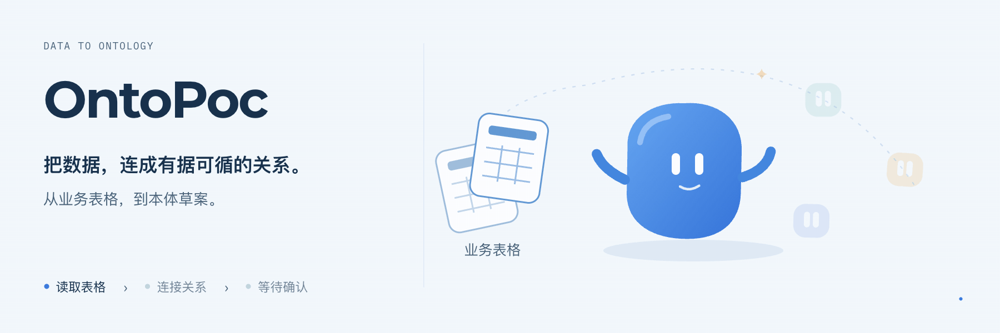

<p align="center">
  <picture>
    <source media="(prefers-color-scheme: dark)" srcset="landing-page/public/assets/ontopoc-logo.png">
    
  </picture>
</p>

<h1 align="center">OntoPoc</h1>
<p align="center"><strong>The confirmation gate between a team's data and the AI that answers questions about it: agents answer only from definitions a named person confirmed against the current data, otherwise they refuse and say who can confirm.</strong></p>
<p align="center">Ontology tool for teams and MCP / Claude: data → definitions → checks → confirmation → gated answers, boards and agents.</p>

<p align="center">
  <a href="LICENSE"></a>
  
  
  
  
</p>

<p align="center">
  <a href="README.md">中文</a> ·
  <a href="https://longado.github.io/ontopoc/">Docs</a> ·
  <a href="#quick-start">Quick start</a> ·
  <a href="docs/pilot/FIRST_DEFINITION.md">Try it</a> ·
  <a href="#for-agents-mcp--claude">MCP / Claude</a> ·
  <a href="#ontology-faq">Ontology FAQ</a> ·
  <a href="#contributing">Contributing</a>
</p>

<p align="center"><sub>Ontology tool for MCP / Claude · Docs: <a href="https://longado.github.io/ontopoc/">longado.github.io/ontopoc</a> · Follow on X: <a href="https://x.com/linyutai120479">@linyutai120479</a></sub></p>

<p align="center">
  
</p>
<p align="center"><sub>Concept illustration · <a href="docs/media/ontopoc-poster.png">Still image</a> · <a href="docs/media/ontopoc-motion.mp4">MP4</a></sub></p>

OntoPoc is an ontology tool for a team's own data. The team writes down what its tables mean: object types and their keys, what each code in a column means, relations, views such as "valid orders", derived properties. That is the team's ontology, the part of a semantic layer that says how a number is worked out. Code checks each definition against every row, and a second, named person confirms it on a given version of the data. Q&A, boards and AI agents over MCP then answer only from what was confirmed. When the data or a definition changes, what rests on it goes back for another look, and questions that use it are refused, naming the definition and who can confirm it. It is not a knowledge-graph platform or a data platform; it is still in development and nobody but the author uses it yet.

## How it refuses

Three outcomes, all on the bundled sample data (150 orders, status codes 0 to 5), which the [live demo](https://35-229-236-140.sslip.io/) (temporary address) also serves to read-only guests:

| You ask | OntoPoc says | Why |
|---|---|---|
| "Total amount of valid orders?" | **119,810**, with the line it rests on: the view *Valid orders* (paid, shipped, delivered), who confirmed it, on orders v1 | Every definition the answer uses is confirmed |
| A question that names a definition nobody has confirmed yet | Held back before the model is asked, naming the definition and who can confirm it | Proposed is not confirmed. A person who may see the definition gets its name and who can confirm it; a viewer, who only reads confirmed definitions, is not told the names of definitions never confirmed, and for a confirmed one waiting for another look is told only that the answer waits for a confirmation |
| The same question after `orders_update.csv` arrives (new code 6, nobody gave it a meaning) | Refused: *Valid orders* needs another look; a board shows that it waits and the last number | The data changed under the confirmation |

One question gives one number, and code decides which rows it covers, not the model. A confirmed view is applied only when the question says its name; otherwise the number covers every row you may read, and each confirmed view on that type that you may see is listed beside it with its own number and who confirmed it. A condition the model adds that the question does not say is not applied; a confirmed name said in another language (the demo's names are English) is refused with the name to use.

On the live demo a guest gets the first answer and one refusal of the third kind: the type Customer was confirmed once and now waits for a second look, so a question that writes its name, Customer (any case, singular or plural, as a whole word, for example "Valid order amount by Customer city"), is refused before the model is asked, and the guest is told only that the answer waits for a confirmation. "客户" is not its name, and such a question goes to the model as usual.

The sum of the amount column is 162,960. It is arithmetically right and it is not revenue: cancelled and refunded orders still carry an amount. That gap is what the gate is for.

## How a definition gets confirmed

1. **Put it forward.** A builder writes the definition, asks the model to suggest one from the datasets, or imports the tests of a dbt `manifest.json` (a suggestion or an import is only a proposal).
2. **Code checks it on every row.** Keys are unique and filled, relations connect (and say how many rows do not), every code has a meaning. A key check over no rows does not count as passed (relation checks do not yet make that distinction).
3. **A second builder confirms it.** Never the one who proposed it; with one builder the rule opens up and the log says so. The confirmation keeps who, when and which data version.
4. **It is used.** Q&A, boards and agents see it, each number with the line it rests on.
5. **It goes back when things move.** A new upload or pull re-checks it; if it no longer holds, it and what reads it go to "needs another look", with the cause (data changed, definition changed, upstream). The review queue brings it back to step 3.

Walk through it in 40 minutes with two people: [docs/pilot/FIRST_DEFINITION.md](docs/pilot/FIRST_DEFINITION.md).

## Quick start

You need Python 3.11+ and Node 22+. A model key (DeepSeek or OpenRouter) is optional: without one, Q&A and suggestions say the key is missing and everything else works.

### One command (Mac / Linux)

```bash
git clone https://github.com/Longado/ontopoc.git && cd ontopoc && ./scripts/ontopoc-start.sh
```

It installs the dependencies, builds the page, makes the first admin on the first run, and serves the page and the API on one address, `http://127.0.0.1:8767/`; data lives in `~/.ontopoc/data` (`ONTOPOC_DATA_DIR`, `ONTOPOC_PORT` to change). For a team behind HTTPS see [docs/DEPLOY.md](docs/DEPLOY.md). To try it with your team for two weeks, use the [pilot kit](docs/pilot/README.md).

### Option A: let your AI install it

Paste this into Claude Code or Codex:

```text
Install and run OntoPoc (https://github.com/Longado/ontopoc) on this machine:
1. Read the repository's README.en.md and follow "Quick start".
2. Check python3 --version ≥ 3.11 and node --version ≥ 22; if not, tell me how to install them and stop.
3. Clone the repository, run python3 -m pip install -e '.[sources]' in the repository root ([sources] adds the PostgreSQL and MySQL drivers; if the system Python does not allow a direct install, create a virtual environment first), and run npm ci in landing-page.
4. Ask me for a model key (DeepSeek or OpenRouter) and put it only in this terminal's DEEPSEEK_API_KEY or OPENROUTER_API_KEY; do not write it to any file.
5. From the repository root, first make the admin: PYTHONPATH=src python3 -m ontology_poc_generator.accounts create-admin (I type the name and password myself).
6. Then start the service: PYTHONPATH=src python3 -m ontology_poc_generator.ontology_server --origin http://127.0.0.1:5178
7. In another terminal, start the page: cd landing-page && npm run dev -- --host 127.0.0.1 --port 5178 --strictPort
8. Open http://127.0.0.1:5178/, sign in, upload docs/pilot/sample/orders.csv and customers.csv, and tell me how many rows each dataset shows.
```

### Option B: install it yourself

```bash
git clone https://github.com/Longado/ontopoc.git && cd ontopoc
python3 -m pip install -e '.[sources]'   # sources: the PostgreSQL and MySQL drivers; if the system Python does not allow it, first run python3 -m venv .venv && . .venv/bin/activate
(cd landing-page && npm ci)

# first time: make the admin on the machine the service runs on (asks for a name and a password of at least 12 characters)
PYTHONPATH=src python3 -m ontology_poc_generator.accounts create-admin

# terminal 1: the service (port 8767, data in output/ontology-runs/workspace.sqlite; --data-dir for another folder)
export OPENROUTER_API_KEY=your-key          # or DEEPSEEK_API_KEY; optional
PYTHONPATH=src python3 -m ontology_poc_generator.ontology_server --origin http://127.0.0.1:5178

# terminal 2: the page
cd landing-page && npm run dev -- --host 127.0.0.1 --port 5178 --strictPort
```

The admin adds other people on the Users page. After changing backend code, restart the service; the page says so when it finds the service running old code.

Model: `DEEPSEEK_API_KEY` goes to DeepSeek's own API. With only `OPENROUTER_API_KEY` it goes to OpenRouter, `deepseek/deepseek-v4.1-flash` by default. `EIP_MODEL_API_BASE` and `EIP_MODEL_NAME` name another OpenAI-compatible endpoint and model.

## For agents (MCP / Claude)

An outside agent connects as a named person, with a personal token an admin makes on the AI tool access page. With `ONTOPOC_TOOLSET=read` set, as in every command below, or with a read-only token (what that page offers first), it gets only six read-only MCP tools, worked out with that person's permissions:

| Tool | What it does |
|---|---|
| `describe_definitions` | The confirmed object types, properties, code meanings, relations, views and derived properties, with the refusal rules |
| `ontopoc_query` | Work out a number straight from an ontology query ([QUERY.md](docs/QUERY.md)): no model |
| `ask` | Ask in one sentence when a query cannot be written; the model writes the query, code runs it |
| `list_unconfirmed` | What cannot be used yet, and why |
| `read_derived_property` | The value of a confirmed derived property |
| `definition_standing` | Whether each definition is confirmed now, by whom and on which data version; for one that is not, why and who can confirm it. The same is at `GET /api/workspace/agent/standing`, with a CSV download |

What it refuses: anything that rests on a definition that is not confirmed, or needs another look, or that the token's person may not see. The refusal is passed on as it is, with the reason; no guessed answer. These six tools cannot upload, write definitions or confirm. A token with the scope "all" (the default for a token a person makes on their own account page) used without `ONTOPOC_TOOLSET=read` also exposes the earlier screen's 34 run tools, which can upload files, build and confirm there; so set it. Start the service first, then, from the repository root:

```bash
claude mcp add ontopoc -- env ONTOPOC_TOKEN=<your token> ONTOPOC_TOOLSET=read PYTHONPATH=$PWD/src python3 -m ontology_poc_generator.mcp_server
```

The AI tool access page shows a JSON block for Claude Desktop, Cursor and other MCP clients, with the service address filled in; add `"ONTOPOC_TOOLSET": "read"` to its `env`. The full list is in [docs/MCP.md](docs/MCP.md). The page also offers a skill pack (zip): a snapshot of the confirmed definitions that does not refuse when the data changes later, so prefer MCP.

**Claude Code plugin.** The repository is also a Claude Code plugin (`claude plugin marketplace add Longado/ontopoc`, then `claude plugin install ontopoc@ontopoc`). Its two commands, `/ontopoc:ontopoc-build` and `/ontopoc:ontopoc-review`, still work on the earlier run-based screen, not on the team app's gate; see [docs/LEGACY_SCREEN.en.md](docs/LEGACY_SCREEN.en.md).

## What is in it, and what it does not do

| Part | What it does |
|---|---|
| Accounts and permissions | Local accounts with three roles (admin, builder, viewer) and server-side sessions. A viewer reads confirmed definitions only. An admin can limit an object type to named people, limit rows by rule (allow-lists only), hide a column, and keep a column's values from the model |
| Data | Upload CSV or Excel, update by key or overwrite, a new version each time, with the rows counted on the way in. Read-only PostgreSQL and MySQL: a pull **copies** the table into a new version, at most 500,000 rows and about 200 MB per pull; a larger table is refused, not cut short. Only PostgreSQL and MySQL; checking in place in your database is not built. Schedules pull or run pipelines hourly, daily, weekly |
| Definitions | Object types (key, properties, what code columns mean), relations (how many rows connect, whether the declared cardinality holds), views, derived properties (a formula over a row, or a statistic through relations) |
| Confirmation | Proposed → checked by code → confirmed by another builder, with the data version and anchors kept. When the data or a definition changes, what no longer holds goes back to "needs another look", and whoever can confirm it, and whoever confirmed it last, gets one notice in Notifications. One exception for relations: one confirmed with every row connected and no repeated key stays confirmed while that is still true, even when the row counts changed. What one upload moved can be confirmed together on one screen |
| Answers | Q&A: a question that names an unconfirmed or stale definition is refused before the model is asked. The model sees structure, meanings and the values of columns with few distinct values, never rows, and writes a structured query; code runs it and checks the definitions it used. OntoPoc Query works out numbers with no model. Boards answer through the same gate |
| Around it | Light pipelines (filter, join, group, dedupe, calculated columns, union, split), the lineage and relation graphs (coloured by why something went back), an object explorer, English and Chinese pages |

It does not do heavy orchestration, large data, live queries against your database, or a wide choice of charts. Actions (approved writes to data) and the AI steps inside pipelines are still there but off the main path. The earlier run-based screen is at `legacy.html` (last line below).

## Privacy

- Uploaded files, pulled tables and all results stay on the machine running the service.
- The model sees the names and types of object types and properties, confirmed code meanings, relations, what derived properties say, and every value of columns with few distinct values (such as city or tier). Key columns and columns an admin marks "don't send values" send no values. No rows are sent.
- Each model call leaves one line in `model_calls.jsonl` (which agent, how long, success or failure), never the content.
- What the earlier screen sends to the model is in [docs/LEGACY_SCREEN.en.md](docs/LEGACY_SCREEN.en.md#what-the-model-sees).

## Known issues

See [docs/KNOWN_ISSUES.en.md](docs/KNOWN_ISSUES.en.md).

## Ontology FAQ

### What is ontology engineering here?

Writing checkable definitions for business objects: how each is identified, what its codes mean, which rows count (a view) and which relations hold. In OntoPoc a person or a model puts a definition forward, code checks it against the data, and a different person confirms it.

### How is an ontology different from a knowledge graph?

An ontology first states which objects exist, how they are identified, and which relations are allowed. A knowledge graph usually also contains the specific instances and their links. OntoPoc keeps to the former, on data copied into its own workspace; it is not a knowledge-graph platform and does not provide a durable instance store.

### How is this different from generating an ontology automatically?

Recent work has a language model do most of the building of an ontology or a graph from text: AutoOntic ([arXiv 2611.15467](https://arxiv.org/abs/2611.15467)) induces types, a hierarchy and relation constraints, and Causals ([arXiv 2611.16267](https://arxiv.org/abs/2611.16267)) is a graph built from news. Both say what they leave unmeasured: AutoOntic's evaluation "does not directly measure extraction precision", and the Causals release "has no representative estimate of semantic accuracy". OntoPoc works on the step after drafting, and mainly on tables: code checks each definition against the data, a named person confirms it, and it goes back for another look when the data changes. A model may draft a definition, but Q&A and agents do not use it before those checks and a confirmation; until then a board shows a number that rests on it only to builders and admins, in grey with the reason, and not to viewers.

### How does this relate to a semantic layer?

Your metrics may already be defined in a semantic layer on a warehouse. Who signed them? Who notices when the data changes underneath? OntoPoc is about that part: each definition carries the person who confirmed it and the data version, goes back for another look when the data moves, and the AI refuses to use it until someone confirms it again. It keeps its own copy of the data. If you use dbt, upload `manifest.json` on the object types page: OntoPoc reads its model tests (unique, not_null, relationships, accepted_values) and proposes object types and relations, at most 50 per import and shown as a preview before anything is written; another builder still confirms each against the data. It does not read composite keys, dbt constraints, metrics, the semantic layer or dbt Cloud, it does not follow later changes to the manifest, and the import confirms nothing. It does not export to a specific semantic layer yet.

### What is an ontology MCP, and how do I use it here?

Here, ontology MCP means an agent reading a team's confirmed ontology through MCP tools. With `ONTOPOC_TOOLSET=read` or a read-only personal token, OntoPoc's MCP server gives an agent six read-only tools (read definitions, ask, run an OntoPoc Query, list unconfirmed items, read a derived property, see whether each definition is confirmed now) for clients such as Claude Code, Claude Desktop and Cursor, over local stdio. Setup is under [For agents](#for-agents-mcp--claude); the list is in [docs/MCP.md](docs/MCP.md).

### Who is OntoPoc for today?

A small data team (three to eight people, ops, finance, data) that wants an AI to answer questions about its own tables, and wants it to refuse rather than answer quietly wrong. Builders write definitions and confirm each other's; viewers ask questions and read boards. Nobody outside the author has used it independently yet; the page has only been used on macOS.

## Contributing

**Does a team's AI refuse at the right moments, and only then?**

| Area | Contribution |
|---|---|
| Pilot | Run the [pilot kit](docs/pilot/README.md) with a small team and send the question log: right, wrong, refused, and whether each refusal was for a good reason |
| Checks | Find a definition that passes the checks and is still wrong on real-looking data, and file it with the data |
| Agents | Connect an MCP client with a read-only token and report where the refusal rules were unclear to it |
| Prompts and evaluation | Pick accepted answers as labelled samples and compare old and new prompts with one command |
| Cross-platform | Run it on Windows or Linux and file what breaks |

Issues and pull requests are welcome. Read the [development guardrails](docs/DEVELOPMENT_GUARDRAILS.md) first. Sign-in, roles, tokens and two-person confirmation are in [docs/ACCOUNTS.en.md](docs/ACCOUNTS.en.md); the service has no default account or password.

## Development

```bash
PYTHONPATH=src python3 -m unittest discover -s tests -q      # backend tests (2,467 on 2026-11-20; install ".[check,sources]" first, or TTL and some source checks are skipped)
npm --prefix landing-page run test:unit                       # page tests (833 on 2026-11-20)
PYTHONPATH=src:. python3 scripts/real_model_check.py --out /tmp/check   # real model against SQL (needs a model key; fails only on a wrong number)
PYTHONPATH=src python3 -m ontology_poc_generator.ontology_server --data-dir /tmp/ontopoc-trial   # a trial run in another data directory
```

Page code: the team app is in `landing-page/src/app/` and uses only `/api/workspace/*`; the earlier screen is in `landing-page/src/legacy/`. The design documents are in Chinese:

| Document | About |
|---|---|
| [docs/PRODUCT.md](docs/PRODUCT.md) | What OntoPoc is for, and what it keeps and leaves out |
| [docs/QUERY.md](docs/QUERY.md) | OntoPoc Query |
| [docs/MCP.md](docs/MCP.md) | The MCP tools |
| [docs/AGENTS.md](docs/AGENTS.md) | Every model call: its definition card and the call log |
| [docs/DEVELOPMENT_GUARDRAILS.md](docs/DEVELOPMENT_GUARDRAILS.md) | Red lines, and directions waiting for a trigger |

## License

[AGPL-3.0](LICENSE) © Yutai Lin. v0.2.0 and earlier stay under MIT; for a commercial license, see [NOTICE.md](NOTICE.md).

---

The earlier screen, organised around one modelling run at a time (drafting an ontology from a few tables or a document, the caliber card, object forms and Turtle export; a PDF upload there also needs `pdftotext` from poppler), is still at `legacy.html`: [docs/LEGACY_SCREEN.en.md](docs/LEGACY_SCREEN.en.md).
