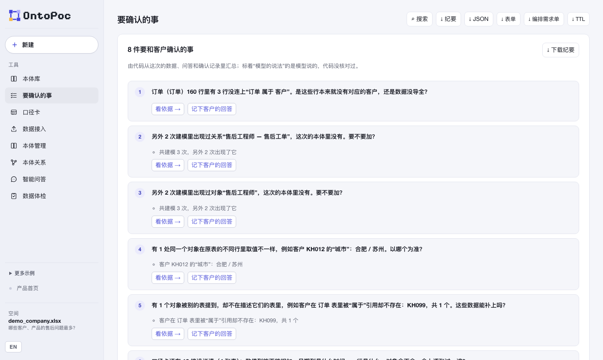
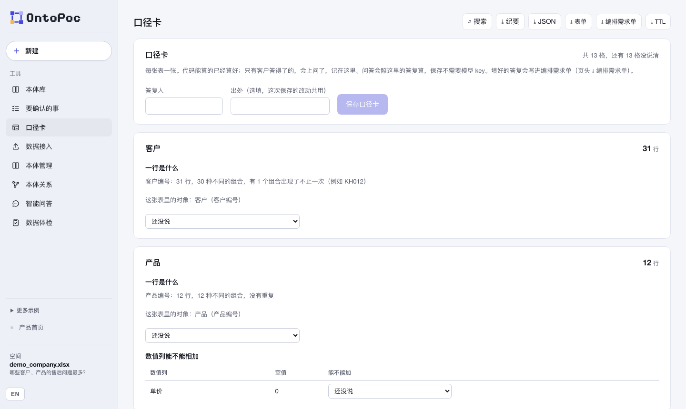
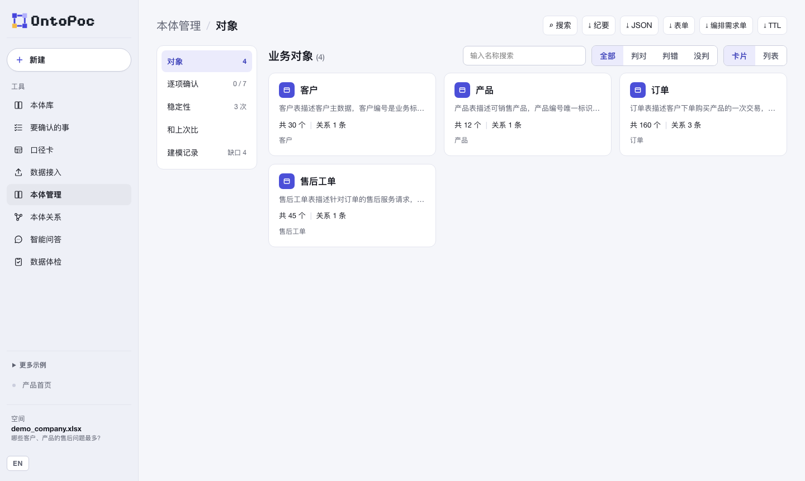
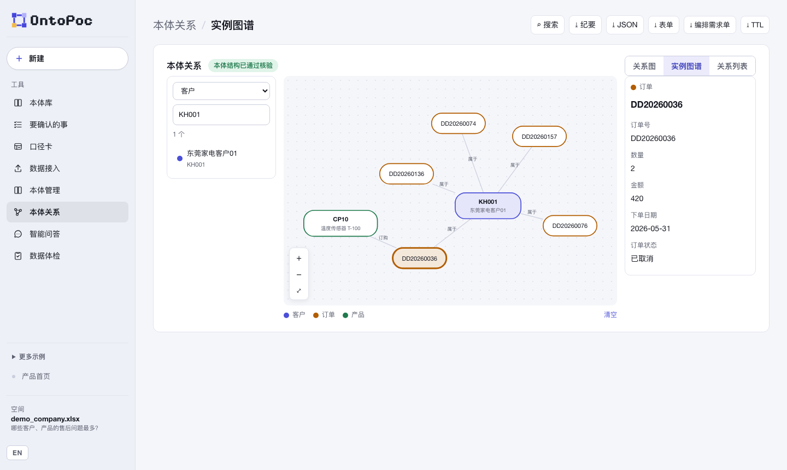
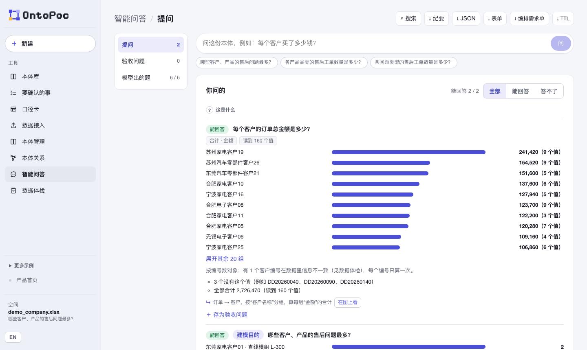
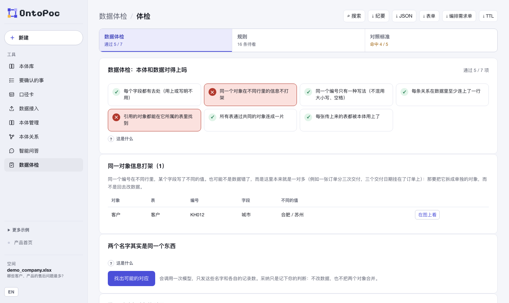

<p align="center">
  <picture>
    <source media="(prefers-color-scheme: dark)" srcset="landing-page/public/assets/ontopoc-logo.png">
    
  </picture>
</p>

<h1 align="center">OntoPoc</h1>
<p align="center"><strong>还在开发中的方向：从业务数据起草本体，用代码对照数据检查，由人逐项确认。</strong></p>
<p align="center">设想中的使用者是数据平台的实施顾问：第一次拿到客户数据时，用它梳理业务对象及其关系。</p>

<p align="center">
  <a href="LICENSE"></a>
  
  
  
  
</p>

<p align="center">
  <a href="README.en.md">English</a> ·
  <a href="#快速开始">快速开始</a> ·
  <a href="#快速体验">快速体验</a> ·
  <a href="#用-mcp--claude-接入">MCP / Claude</a> ·
  <a href="#本体-faq">本体 FAQ</a> ·
  <a href="#参与共建">参与共建</a>
</p>

<p align="center"><sub>Ontology engineering · 在 X 跟进：<a href="https://x.com/linyutai120479">@linyutai120479</a></sub></p>

<p align="center">
  
</p>
<p align="center"><sub>功能主题插画 · <a href="docs/media/ontopoc-poster.png">静态版</a> · <a href="docs/media/ontopoc-motion.mp4">MP4</a></sub></p>

OntoPoc 是一个还在开发中的方向，不是成品。在试的是：从几张业务表或一份文档起草本体，由代码对照数据检查草稿，再由人逐项确认并存下来。现在没有作者以外的用户，也还没和直接用通用编程助手（例如 Claude Code 加 pandas、DuckDB）做同样的事比过。

## 简介

用户上传若干业务表（Excel、CSV）或一份流程文档后，OntoPoc 生成本体草案，包括业务中的对象、各对象的识别字段以及对象之间的关系。起草时，代码先在全部行上数出每列有几种值、哪些列每行都不同、哪些列的值能在别的列里找到，模型看字段名、至多 3 个示例值和这些计数起草；代码再按 14 类错误检查草稿，例如字段是否存在、识别字段是否有值、关系有没有连上的行，不通过就退回，至多 3 轮。在此基础上，系统执行数据质量检查，并基于数据回答业务问题。文档也可按「组织架构」读，梳理出组织单元、岗位、人与工作环节及其隶属、协作、交接关系，每条都附原文出处。顾问逐项确认后，结果将被保存；同一文件或其新版本再次上传时，系统以此为基准进行比对。

数据里说不清、只有客户答得了的事，代码汇总成一张“要确认的事”清单，每条附依据和一句可以直接问客户的话；每张表另有一张口径卡，写明一行是什么、日期是什么时间、数值能不能相加。会上记下客户的答复，问答即按这些答复计算。

上传的每张表同时存进本机一个 `workspace.sqlite`：每个版本一张表，每次导入核对行数（文件里的行数 = 存进去的行数 + 被丢掉的空行和标题行），每项检查连同查询和看过的行数一并记下，每个确认写成带确认人和依据的状态。人确认过的定义（状态码 2 是什么、重复的编号取哪一行、什么算有效订单）由此变成可读的命名视图，问答、编排和答案核对都读这一处，而不是靠模型自己记得。

建模结果可按数据平台的对象表单导出，可导出给搭数据管道的人看的编排需求单和一页会议纪要，也可按 W3C 标准导出为 Turtle（OWL 与 SHACL）；部分功能已封装为 MCP 工具，可供其他 Agent 调用（新增的定义与连接功能暂无）。

> **早期版本。** 目前只在公开数据和合成数据上试过（美国联邦采购、芝加哥市政合同、Northwind、BART 地铁、台湾公司登记、CMS 医院等）。尚无作者以外的用户独立完成全流程，也还没和通用编程助手直接做同一件事比过。页面仅在 macOS 上实际用过；尚未在任何数据平台上实测批量导入。单个文件，或一次上传的多张表合计，不超过 10 MB；模型只接 DeepSeek 的托管接口，没有本地模型选项。详见[已知问题](#已知问题)。

## 界面预览

<p align="center"></p>
<p align="center"><sub>要确认的事：示例工作簿上汇总出 8 件，每件附依据和一句可以直接问客户的话（截图是上一版的清单样式，现在是逐张卡片）。</sub></p>

<p align="center"></p>
<p align="center"><sub>口径卡：代码已算出每张表按哪几列唯一；一行是什么、数值能不能相加，留给客户答。</sub></p>

<p align="center"></p>
<p align="center"><sub>本体管理：示例工作簿生成的 4 个业务对象；左侧为逐项确认、稳定性、和上次比与建模记录。</sub></p>

<p align="center"></p>
<p align="center"><sub>实例图谱：由客户 KH001 展开至其订单，再由订单展开至产品；右侧为所选订单的原始字段值。</sub></p>

<p align="center"></p>
<p align="center"><sub>智能问答：模型将问题转写为结构化查询，数值由代码基于上传数据计算，并注明参与计算的值数。</sub></p>

<p align="center"></p>
<p align="center"><sub>数据体检：这次示例的结果是 7 项检查通过 5 项，没通过的 2 项是示例里预置的问题，下方列出出问题的对象。</sub></p>

以上截图均基于仓库内置的合成示例 `examples/company/demo_company.xlsx`，由无头浏览器离屏渲染。

## 工作原理

| 操作 | 系统行为 |
|---|---|
| 打开左侧“本体库” | 搜索、按领域浏览 12 份 Playground 参考本体，在图上查看对象、属性和关系；也可导入 RDF/XML 格式的 `.rdf/.owl`。这里只看定义，导入不调用模型，刷新后需重新选文件 |
| 上传数据表并填写建模目的 | 代码先在全部行上数出每列有几种值、哪些列每行都不同、哪些列的值能在别的列里找到；模型读取每列字段名、至多 3 个示例值和这些计数，提出对象、识别字段与关系；代码按 14 类错误校验，不通过则退回修改，至多 3 轮 |
| 建模完成 | 同一文件并行建模 3 次，标出三次结果不一致的地方，交给人判断；三次只比对象和关系，不比属性。建模目的里写了问题的，一并用数据算出答案，可直接存为验收问题 |
| 打开“要确认的事” | 代码从数据、问答和确认记录里汇总要和客户确认的事，例如关系连不上的行、名字相同编号不同的对象、问答里模型自己加的筛选条件；每次一张卡，附依据、取自上传表的最多 3 行例子和核对结果，页顶写着“还剩几件、已定几件”；按 1–4 答复（确认、不对、不适用、已知例外，外加这件事自己的选项），J / K 换卡；选项都不是时可以只写几句话；每种答复各留各的草稿；“还剩几件”不算口径卡和“没判过的对象”这两张只能去别处做的卡；已定里的答复可以收回并带着原来写的字改，代码含义、“不是代码”和重复编号的处理办法也能收回；一份更新版本出来后，旧版本上的答复和收回都会被拒绝。每个答复记着谁答的、是逐件判断还是批量确认；“不适用”和“已知例外”（要写原因）记下后，再上传不会重新问，除非它依据的数据变了。只有代码能整个核对完的才列成一张清单：两头对象已判对、每一行都连上、被连的表里没有重复编号，并且关系方向是声明过且数据里成立的，或没有声明但按数据算是一对一、多对一（清单里写明是哪一种）。看过后可以一起通过，记成“批量确认”，只写通过的这几件，别人之前签的判断和版本不动；服务在通过时会在写入的事务里再算一遍，清单变了就一件都不通过。代码含义是人对数据的解释，数据证明不了标签对不对，不进清单，只能逐件确认；通过后的关系在“已定”里列着，写明谁、批量确认。名字和算法对不上的列也在这里：叫“交付天数P50”的列，代码用另一张表的行重算，发现它其实是平均数，就列为待确认项（改名或保留）。已确认的代码含义、重复编号的取法、命名视图和关系，都记着确认时看到的数据；再上传的数据变了（如状态码整体错位），这条确认标为“需要再看一眼”，在人再确认前不当作已确认使用 |
| 打开“数据接入” | 每张表导入时核对行数与主键（空编号、重复编号），列出被丢掉的行和原因。代码从数据里找出像代码的列（状态码 1/2/3），每个值附行数和证据，由人填写含义；某张描述对象的表里编号重复时列为待确认项，选“全保留 / 按某列取最新 / 当数据错误”。人确认过的定义生成命名视图（如“有效订单”“最新快照”），列出其 SQL 与行数；定义失效时标为不可用并写明原因。每条关系都在存下的表上核对：连上多少行、哪些编号找不到（如 3 张订单写了客户里没有的 KH099）、描述一端是否有重复编号，以及声明的基数是否成立 |
| 在“数据接入”里连接两张表 | 选两张表（或视图）和连接列，显示每个节点的输入与输出行数；连接后行数比左表多时，指出哪些编号在右表重复、哪些金额合计会被重复计算。例：测试用的合成表里，订单 160 行左连售后工单变成 169 行 |
| 打开“口径卡” | 每张表一张：一行是什么、日期列是什么时间、数值列能不能相加。代码能算的已经算好，只有客户答得了的格留给会上填；填好的答复用于问答计算，并写进编排需求单 |
| 打开"数据体检" | 代码对数据执行 7 项检查，例如同一编号的属性是否冲突、每张上传的表是否均被使用。关系一项只要求每条关系至少连上一行，页面会写出连上了多少行 |
| 智能问答 | 模型将问题转写为结构化查询，由代码基于数据计算答案；答案会写明“理解为…”：模型按哪个已确认的定义读了这个问题（含“已取消的”“不算已取消”这类方向），代码对照实际执行的查询核对；没声明、没用到或名字对不上的，拒答并说明怎么读的。无法回答时说明原因：本体缺失、数据缺失或查询不支持。需要按公式算的金额（单价 × 数量 ×（1 − 折扣））由模型提出公式，代码在每一行上试算，确认后原题重算并答出。答案带有模型自己加的筛选条件时单独列出，可去掉该条件重算。也可以让模型按需出一组 6 道题 |
| 查看关系绑定 | 显示来源表与两端编号列，如 `EmployeeId → ReportsTo`；端点引用只连接已存在对象，不把下属属性写到上级。核验失败时显示位置、原因及修改提示 |
| 逐项确认、重命名、补充对象 | 保存为该文件的参考本体，再次上传时自动比对并预填 |
| 设定验收问题（至多 3 道） | 每次重新运行以相同查询复算，仅提示结果发生变化的问题 |
| 采纳数据规则 | 每次重新运行均校验，列出违反规则的对象 |
| 标记上传文件为新版本 | 沿用上一版的确认（含判错）、验收问题与规则，并统计各对象的新增与减少数量；模型再次提出此前判错的对象时单独提示 |
| 生成对象表单草稿 | 一次模型调用，生成中文名称、描述与展示字段；人工修改过的内容不会被再次生成覆盖 |
| 导出对象表单 | 每个对象生成一份 CSV，列为数据平台建对象时的常见表单列 |
| 点击右上角"⤓ TTL" | 导出三份 Turtle 文件：`ontology.ttl` 用 OWL 描述对象、字段、关系与识别字段；`data.ttl` 中每个对象按识别值命名，同一对象跨表、跨版本同名，可直接合并；`shapes.ttl` 将已采纳的规则写成 SHACL，可用通用校验器检查。判错的对象与关系不导出 |
| 点击右上角“⤓ 编排需求单” | 下载压缩包（Markdown 与 JSON 各一份），交给搭数据管道的人：数据体检、要确认的事、口径卡答复、已确认的指标与已采纳的规则对数据准备提出的要求，每条注明出处（代码在数据里查到、客户答复或人工确认）。不调用模型，也不改数据 |
| 点击右上角“⤓ 纪要”或按 ⌘K | 纪要：一页 Markdown，要确认的事排在最前，供会上使用；⌘K：在这次运行里搜索对象、字段、关系和表，并跳到所在位置 |

模型只负责判断，循环与计算均由代码完成；模型调用串联至多 3 步，每次调用都对应一个需要人来做的判断。系统共有 6 个 Agent，定义见 [docs/AGENTS.md](docs/AGENTS.md)。

## 快速体验

完成安装（见[快速开始](#快速开始)）后，可用仓库内置的合成示例体验：

| 操作 | 预期结果 |
|---|---|
| 不启动建模服务，点击"打开示例数据表" | 显示内置结果：4 个对象、3 条关系 |
| 上传 `examples/company/demo_company.xlsx`，建模目的填写"哪些客户的售后问题最多？" | 约半分钟至一分钟后生成客户、产品、订单、售后工单 4 个对象；数据体检 5 / 7 项通过，未通过的 2 项即示例中预置的问题；“智能问答 › 提问”里这道题已用数据答出 |
| 打开“要确认的事” | 内置示例是 8 件要和客户确认的事（件数随三次建模是否一致而变），其中包括预置的问题：客户 KH012 在两行里城市不同，订单引用的 KH099 不在客户表里 |
| 在智能问答中提问"每个客户的订单总金额是多少？" | 按客户排序的合计金额，最高为 241,420，共计 160 个值 |
| 本体关系 → 实例图谱，选择一个客户 | 以图谱展示该客户及其订单，点击订单可继续展开产品 |
| 点击右上角"⤓ 表单" | 下载压缩包，内含 4 份对象表单 CSV 及一份导入说明 |

## 快速开始

环境要求：Python 3.11+、Node 22+，以及 DeepSeek API key。上传 PDF 另需本机装有 `pdftotext`（poppler）。

### 方式 A：由 AI 助手安装

将以下内容粘贴至 Claude Code 或 Codex：

```text
请在本机安装并运行 OntoPoc（https://github.com/Longado/ontopoc）：
1. 阅读仓库的 README.md，按"快速开始"操作。
2. 检查 python3 --version ≥ 3.11、node --version ≥ 22；不满足时告诉我安装方法，并暂停后续步骤。
3. 克隆仓库，在仓库根目录执行 python3 -m pip install -e .（安装读 Excel 用的 openpyxl；系统 Python 不允许直接安装时，先建虚拟环境），在 landing-page 目录执行 npm ci。
4. 向我索取 DeepSeek API key，仅写入当前终端的环境变量 DEEPSEEK_API_KEY，不要写入任何文件。
5. 在仓库根目录启动建模服务：PYTHONPATH=src python3 -m ontology_poc_generator.ontology_server
6. 另开一个终端启动页面：cd landing-page && npm run dev -- --host 127.0.0.1 --port 5178 --strictPort
7. 打开 http://127.0.0.1:5178，上传 examples/company/demo_company.xlsx，告诉我"数据体检"通过了几项。
```

### 方式 B：手动安装

```bash
git clone https://github.com/Longado/ontopoc.git && cd ontopoc
python3 -m pip install -e .        # 读 Excel 用的 openpyxl；系统 Python 不允许时先 python3 -m venv .venv && . .venv/bin/activate
(cd landing-page && npm ci)

# 终端 1：建模服务（端口 8767，结果保存在 output/ontology-runs/）
export DEEPSEEK_API_KEY=你的key
PYTHONPATH=src python3 -m ontology_poc_generator.ontology_server

# 终端 2：页面
cd landing-page && npm run dev -- --host 127.0.0.1 --port 5178 --strictPort
```

访问 `http://127.0.0.1:5178`。未配置 key 时仍可查看内置示例。修改后端代码后需重启建模服务，页面检测到服务运行旧代码时会提示。

## 用 MCP / Claude 接入

OntoPoc 的一部分功能封装为 32 个 MCP 工具，也可作为 Claude Code 插件安装（新增功能还没有对应工具，见下）。工具与页面共用本机建模服务：先启动服务，再接入客户端。

### 作为 Claude Code 插件安装

仓库本身就是一个 Claude Code 插件。安装后可在 Claude Code 里直接建本体、逐项确认；建模、核验和确认记录仍在本机 OntoPoc 服务里完成，使用前需要先启动它（见上文）。

```bash
claude plugin marketplace add Longado/ontopoc
claude plugin install ontopoc@ontopoc
```

新开一个会话后可用两个命令：`/ontopoc:ontopoc-build`（上传文件建本体）与 `/ontopoc:ontopoc-review`（逐项确认）。会话开始时，若本机服务没有运行，插件会提示一行。插件按 `ONTOPOC_PYTHON`、`python3`、`python` 的顺序寻找 Python。

### 接入 Claude Code 或其他 MCP 客户端

这 32 个工具覆盖建模、查看、问答、确认和导出，与页面共用同一个本机服务，可在 Claude Code 等客户端中直接调用（在仓库根目录运行）。新增的下列功能还没有 MCP 工具，目前只能在页面或 HTTP 接口里用：保存代码含义、保存重复编号的取法、命名视图、两表连接、对重新上传后“需要再看一眼”的确认再确认；要确认的事和问答的核对结果会经现有工具带出，但这些改动本身不能通过 MCP 做。

```bash
claude mcp add ontopoc -- env PYTHONPATH=$PWD/src python3 -m ontology_poc_generator.mcp_server
```

工具清单见 [docs/MCP.md](docs/MCP.md)。

## 功能模块

| 模块 | 内容 |
|---|---|
| 本体库 | 12 份 Playground 参考本体，按领域浏览、在图上看对象和关系；可导入 RDF/XML 格式的 `.rdf/.owl` |
| 要确认的事 | 要和客户确认的事，一次一张卡：依据、例子行、核对结果，按 1–4 答复；可下载会议纪要 |
| 口径卡 | 每张表一张：一行是什么、日期列是什么时间、数值列能不能相加、对象全不全；记下答复人与出处 |
| 数据接入 | 每张上传表的行数、跳过的标题行，以及各列的类型、长度、填充率；导入行数核对、主键检查、代码含义、重复编号的取法、命名视图、两表连接和关系检查；表之间未连通时，提示可用于关联的列 |
| 本体管理 | 对象卡片（支持搜索、按确认结果筛选、卡片与列表视图）；对象详情页：概览、属性（即对象表单）、数据（分页浏览、导出 CSV）、确认；另含逐项确认、稳定性、和上次比、新版本与建模记录 |
| 本体关系 | 自动布局的关系图（支持拖拽与缩放）、实例图谱、关系列表；代码从数据中发现、本体中尚未包含的关系以虚线标示为建议 |
| 组织架构 | 上传公开研究材料时选「组织架构」：组织树、协作交接（箭头上写明交接内容）、角色表、时期、材料未说明之处；可导出 Mermaid 组织图，按年份段分别出图 |
| 智能问答 | 自由提问、验收问题、模型生成的问题（可按能否回答筛选） |
| 数据体检 | 7 项数据检查、数据规则、与参考本体比对 |

侧边栏“更多示例”里另有两个应用示例：用同一方法研判汽车召回范围（NHTSA 公开数据，不需要本机服务），以及食品召回事件 95876 的产品与批号匹配（openFDA，需另启本机召回服务），说明见 [docs/RECALL_EXAMPLE.md](docs/RECALL_EXAMPLE.md)。OntoPoc 与 NHTSA 及任何汽车厂商无关联，候选结果不构成缺陷认定。

## 本体 FAQ

### 什么是 ontology engineering（本体工程）？

在这里，本体工程（ontology engineering）是把业务里的对象、识别方式和对象之间的关系写成可检查的定义。OntoPoc 在试的做法是：从几张业务表或一份文档起草本体草案，由代码对照数据检查，再由人逐项确认后存下来。

### Ontology 和 knowledge graph（知识图谱）有什么不同？

Ontology 先约定「有哪些对象、怎么识别、对象之间可以有什么关系」；knowledge graph 通常还包含具体的实例及其关系。OntoPoc 侧重前者：起草并核对定义，并在本次上传的数据上做检查与问答。它不是知识图谱平台，也不提供持久实例库或线上对象查询。

### 这和 semantic layer（语义层）是什么关系？

语义层常指在数仓或指标平台上，定义业务含义（对象、指标、口径）供查询复用。OntoPoc 做的是更靠前的一步：第一次拿到客户表或文档时，整理对象、识别字段、关系，以及需要和客户确认的口径；可导出对象表单、编排需求单和 Turtle（OWL / SHACL），交给后续的数据平台或管道工作。是否导入某个具体平台，目前尚未实测。

### 什么是 ontology MCP？可以怎么用？

这里的 ontology MCP 指通过 MCP 工具调用本体相关功能。OntoPoc 把页面上的部分能力做成 MCP 工具（共 32 个，新增的代码含义、重复编号取法、命名视图、两表连接还没有），供 Claude Code、Claude Desktop、Cursor 等支持 MCP 的客户端调用。工具走本机 stdio，调用的是本机正在运行的建模服务。Claude Code 也可直接装仓库插件后使用 `/ontopoc:ontopoc-build` 与 `/ontopoc:ontopoc-review`。接法见[用 MCP / Claude 接入](#用-mcp--claude-接入)，工具清单见 [docs/MCP.md](docs/MCP.md)。

### OntoPoc 现在适合谁用？

设想中的使用者是数据平台的实施顾问：第一次拿到客户数据时，用它梳理业务对象及其关系。现在没有作者以外的用户独立完成全流程；页面仅在 macOS 上实际用过。更多边界见[已知问题](#已知问题)。

## 隐私

- 上传的文件及全部结果仅保存在本机 `output/ontology-runs/` 目录。
- 发送给模型（DeepSeek）的内容仅包括：建模目的；每张表的行数、各列字段名、至多 3 个示例值、代码数出的计数（有值个数、不同值个数、是否各不相同）、每张表每行都不同的列或两列组合、可能的连接（包括指向本表的）；像类别那样反复出现的列的全部取值；生成问题时，取值不超过 12 种的列的全部取值，以及你在问答里输入的问题原文；点“起草”字段释义时，各字段的类型和最长长度；点“找出可能的对应”时，只用一个字段识别、取值 2–200 个的对象的全部识别值及各值出现的行数；文档则为正文，每次至多 12 段。建模时将发送的内容，上传前可在页面逐列查看。
- 每次模型调用在本机 `output/ontology-runs/model_calls.jsonl` 记录一行（Agent、耗时、成功与否），不记录调用内容。
- 服务仅接受本机请求。

## 已知问题

- **同类对象关系的问答方向尚不支持。** 员工汇报、父子组织等关系可以按两端字段建模、核验和导出；当前问答遍历无法指定上级或下属方向，会说明限制并停止计算。
- **建模结果存在随机性。** 同一文件三次建模结果常有差异，现在主要在关系上：10-28 在 Northwind 数据上的一次测量，8 类对象、7 条关系，其中 4 条关系三次结果不一致，几乎都是同一条关系方向反了（订单→客户 / 客户→订单）。差异之处会在页面中标出，由人工判断。
- **新旧版本的识别字段可能变化。** 芝加哥合同数据曾有一次由"合同号 + 修订号"改为仅用合同号识别，此时只能比较数量，无法逐一比对，页面会注明"识别方式已变更"。
- **关系检查只要求至少连上一行。** 数据体检里关系那一项，每条关系只要连上一行就算通过，连上的比例很低也一样；页面会写出连上了多少行，请看这个数。
- **定义与连接的范围很窄。** 代码含义只处理一列里的几个取值；重复编号的取法只有三种；表连接只有“输入、连接、输出”三类步骤，连接结果超过行数上限会拒绝运行；名字对算法的检查只认 P50、P90、平均、合计、最大、最小这几类，且需要另一张表里有同名的原始列。以上都只在合成的埋错表和公开数据上试过，没有真实客户数据。
- **答案核对依赖模型如实声明。** 模型说了怎么读定义，代码只核对实际执行的查询有没有用上；模型把读法说错而查询恰好相符时，核对看不出来。查询语言只能表达“某字段等于某值”，“不算已取消”必须有一个已命名的视图才能执行，否则拒答。
- **“需要再看一眼”按数据占比判断。** 某个值的行数占比翻倍或减半（且至少差 5 行）才算变了，这两个数是定的，不是测出来的；变化小于这个线的错位不会被发现。
- **关系推断的召回有限。** 在 17 份已保存的运行（公开数据与合成数据）上逐条移除关系后重新推断，33 条中找回 24 条；在完整本体上未出现误报。
- **查询能力的限制。** 暂不支持按数值条件筛选、限定时间范围、单个问题返回两个数值，以及"哪些项目经常同时出现"一类问题；遇到时系统会如实说明。
- **批量导入尚未实测。** 导出的表单列按数据平台的常见表单整理，但导入格式、主键规则与关系表达因平台而异，尚未在任何平台上实测，因此暂不导出关系表。
- **TTL 仅用 rdflib 与 pyshacl 读回验证过。** 尚未在 Protégé 或图数据库中实际导入。
- **页面仅在 macOS 上实际用过。** 后端与页面的单元测试在 Linux（CI）上通过；Windows 尚未测试。

## 参与共建

**业务人员能否自行读懂、修正本体，并在后续工作中持续使用？**

| 方向 | 可贡献的内容 |
|---|---|
| 用户研究 | 邀请一位非作者的顾问独立完成从上传到导出纪要的全流程，记录受阻环节 |
| 数据质量 | 规则发现目前仅支持"必填"与"日期先后"两类，取值范围、非负等规则需先在真实数据上验证定义 |
| 平台对接 | 在具体数据平台上实测批量导入，补充关系表导出 |
| 提示词评测 | 从本机运行结果中选取已确认样本作为标注集，实现新旧提示词的一键对比 |
| 跨平台 | 在 Windows、Linux 上完整运行，并以 issue 形式反馈问题 |

欢迎提交 issue 或 pull request。开发前请先阅读[开发规范](docs/DEVELOPMENT_GUARDRAILS.md)。

## 开发

```bash
PYTHONPATH=src python3 -m unittest discover -s tests -q      # 后端测试（1424 个；先 pip install -e ".[check]"，否则 TTL 校验的 9 个跳过）
npm --prefix landing-page run test:unit                       # 前端测试（369 个）
PYTHONPATH=src:. python3 scripts/run_company_ontology.py --file examples/company/demo_company.xlsx --output output/demo-run.json
PYTHONPATH=src python3 -m ontology_poc_generator.ontology_server --data-dir /tmp/ontopoc-trial   # 试跑用另一个数据目录，不动已有运行
PYTHONPATH=src:. python3 scripts/make_demo_company.py         # 重新生成合成示例工作簿
```

| 文档 | 内容 |
|---|---|
| [docs/PRODUCT.md](docs/PRODUCT.md) | 开发方向与边界 |
| [docs/PLAYGROUND_INTERNALIZATION.md](docs/PLAYGROUND_INTERNALIZATION.md) | 本体库来源、RDF/XML 导入边界与后续轮次 |
| [docs/AGENTS.md](docs/AGENTS.md) | 6 个 Agent 的定义与调用记录 |
| [docs/MCP.md](docs/MCP.md) | 32 个 MCP 工具 |
| [docs/PLATFORM_FORM_REFERENCE.md](docs/PLATFORM_FORM_REFERENCE.md) | 数据平台对象表单对照 |
| [docs/PRD_ITERATION_9.md](docs/PRD_ITERATION_9.md) | 最近一份迭代计划（第 9 轮，闭环）；之后各轮的改动见已合并 PR 的说明 |
| [docs/DEVELOPMENT_GUARDRAILS.md](docs/DEVELOPMENT_GUARDRAILS.md) | 开发红线与待触发的方向 |

## 许可证

[MIT](LICENSE) © Yutai Lin
