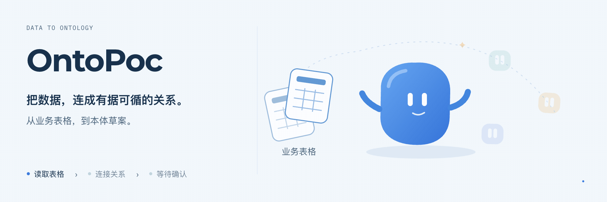

<p align="center">
  <picture>
    <source media="(prefers-color-scheme: dark)" srcset="landing-page/public/assets/ontopoc-logo.png">
    
  </picture>
</p>

<h1 align="center">OntoPoc</h1>
<p align="center"><strong>团队数据和回答问题的 AI 之间的确认关口：AI 只按具名同事对着当前数据确认过的定义回答；没确认的，就拒答并说出谁能确认。</strong></p>
<p align="center">Ontology tool for teams and MCP / Claude：数据 → 定义 → 检查 → 确认 → 受门控的问答、看板和智能体。</p>

<p align="center">
  <a href="LICENSE"></a>
  
  
  
  
</p>

<p align="center">
  <a href="README.en.md">English</a> ·
  <a href="https://longado.github.io/ontopoc/zh/">Docs</a> ·
  <a href="#快速开始">快速开始</a> ·
  <a href="docs/pilot/FIRST_DEFINITION.md">动手试一遍</a> ·
  <a href="#给智能体用mcp--claude">MCP / Claude</a> ·
  <a href="#本体-faq">本体 FAQ</a> ·
  <a href="#参与共建">参与共建</a>
</p>

<p align="center"><sub>Ontology tool for MCP / Claude · Docs: <a href="https://longado.github.io/ontopoc/">longado.github.io/ontopoc</a> · Follow on X: <a href="https://x.com/linyutai120479">@linyutai120479</a></sub></p>

<p align="center">
  
</p>
<p align="center"><sub>功能主题插画 · <a href="docs/media/ontopoc-poster.png">静态版</a> · <a href="docs/media/ontopoc-motion.mp4">MP4</a></sub></p>

OntoPoc is an ontology tool for a team's own data: the team writes down what its tables mean (object types, keys, code meanings, relations, views), code checks each definition against every row, a second named person confirms it on a given data version, and Q&A, boards and AI agents over MCP answer only from what was confirmed. It is not a knowledge-graph platform; it is the confirmed part of a semantic layer.

团队把表格的含义写下来：对象类型和主键、代码列每个取值是什么意思（例如状态码 2 = 已取消）、关系、视图（例如“有效订单”）、派生属性。这就是团队的本体（ontology），也就是语义层里“这个数怎么算”的那一部分。每个定义由代码在全部行上检查，再由另一位具名同事对着某一版数据确认。问答、看板和通过 MCP 接进来的 AI 只用确认过的定义；数据或定义一变，靠它的东西回到“需再看”，用到它的问题拒答，说出是哪一项、谁能确认。OntoPoc 还在开发中，还没有作者以外的用户。

## 它会怎么拒答

三种结果，都在仓库自带的示例数据上（150 张订单，状态码 0–5），[演示站](https://35-229-236-140.sslip.io/)（临时地址）用的也是这份数据，访客只读：

| 你问 | OntoPoc 答 | 为什么 |
|---|---|---|
| “有效订单的总金额是多少？” | **119,810**，旁边写着按什么算的：视图“有效订单”（已付款、已发货、已送达），谁确认的，基于订单第 1 版 | 用到的定义都确认过 |
| 问题点名了一个还没人确认的定义 | 在问模型之前就挡下，说出是哪个定义、谁能确认 | 提出不等于确认。能看到这个定义的人会得知名字和谁能确认；查看者只读已确认的定义，从没确认过的定义不会被告知名字，已确认、正在等再确认的只被告知回答在等确认 |
| 上传 `orders_update.csv`（出现新代码 6，没人写过含义）之后再问同一题 | 拒答：“有效订单”需再看；看板上显示它在等谁、上次的数 | 确认之后数据变了 |

回答算的是全部行时，旁边还给出每个已确认视图各自的数；回答只算一个已确认视图时，旁边还给出全部行的数。上面那个数算哪些行，和以前一样决定。

**关联重复出来的数，不拿来统计。** 管道把订单连到订单行时，每一行订单行都带着它那张订单的金额；在“订单行”类型上把金额加起来，同一张订单会算好几次。运行时代码看结构、不看数值：连接一边只要有一行被带到了不止一行输出上，这一边来的每一列都记下“含重复计算”（总数碰巧对上也一样记；不论是数字还是文字，所以写成文字的金额也逃不掉；页面上的提醒只显示在数字列上）。这个标记跟着列走：同一个管道里后面的转换、计算列、填空、过滤、合并、AI 步骤都带着它，读这个数据集的下一个管道也带着它。去掉它靠量，不靠步骤的种类：连接留下的行号还在时，输出上再量一次，这一边没有一行出现在不止一行上才去掉；分组统计会丢掉行号，这时只有分组列正好是这一边的连接键（不多不少）、这个键在这一边没有重复、统计是最大、最小或去重计数，才去掉。标记只看数据集当前那一版。之后问答、OntoPoc Query、MCP、派生属性、看板和图表、核对过的数、要回答的问题，凡是对这样的列求和、求平均、取中位数或分位数、画分布（包括分组合计），都拒答，并指向出路：到每件事只有一行的类型上去算（例如每个订单一行的那个类型）。能打开这个管道的人会看到是哪个管道，别人看到同一句话但不点名；只能看到部分行的人得到的是同一句话。只拒答，不替你去重。数对象个数、去重计数、取最大最小照常回答（在问答和图表里；OntoPoc Query 能数个数，没有最大最小）；确认这样的类型不会被挡，确认页上同样提醒。

**从旧版本升级。** 旧版本写出的、带连接的管道输出，没有量过重复。升级后，这样的一版上除了计数、去重计数、最大、最小，什么统计都拒答（任何一列），句子说要把哪个管道重新运行一次（只对能打开管道的人点名）；记下的核对过的数显示拒答，要回答的问题回到“需要再看”。升级后请把每个带连接的管道各运行一次；不带连接、只读上传数据的管道不受影响。演示站和示例数据里没有管道，升级后它们的看板和问题照常。

演示站上，访客能看到第一种回答，和一次第三种拒答：类型 Customer 确认过一次、现在在等第二次确认，问题里点到它时，会在问模型之前拒答，访客只会被告知回答在等确认。点到它可以写名字 Customer（不分大小写和单复数，作为一个整词，例如“按 Customer 城市看有效订单金额”），也可以写它的另称“客户”（“按客户城市看有效订单金额”）。

**另称。** 对象类型、属性、代码含义、视图、派生属性都可以有最多 5 个另称，例如英文名字的中文叫法（演示站的视图 *Valid orders* 又称“有效订单”）。问题里用了另称，就和用了名字一样：名字会被挡下的地方，另称也会被挡下；问题说了一个已确认视图的另称、模型却没有读这个视图时，和说了它的名字一样拒答。模型看到它被告知的已确认定义时，也看到这些定义的另称。别的都不变：回答算哪些行，仍然是模型的读法，由代码核对。定义自己的名字总是算数；另称只出现在另一个定义更长的名字里时，那一处不算（演示站上，Customer 的另称“客户”在属性的“客户号”里，不算 Customer）。另称是定义的一部分，确认定义的人连同另称一起确认；另称不能和别的种类的定义的名字相同；同一个范围里两个定义不能用同一个另称，中文名字也不能一个包含另一个；视图的名字不能落在对象类型的名字里（反过来可以，例如“订单”在“有效订单”里）。

金额列直接加总是 162,960。算术没错，但它不是营收：已取消、已退款的订单也带着金额。关口就是为这个差额准备的。

## 一个定义怎么被确认

1. **提出。** 建设者写定义，让模型从数据集建议一个，或者导入 dbt `manifest.json` 里的测试（建议和导入都只是提议）。
2. **代码在全部行上检查。** 主键唯一、没有空值；关系连得上（连不上的有多少也写出来）；每个代码都有含义；对象类型属性上的每条值规则都成立（不能为空；大于、至少、小于、最多某个数，或在两个数之间；是写了含义的代码之一；一个日期不早于另一个），违反的行数出来，最多 20 行按主键列出。数据违反的规则可以先提出，但要等没有一行违反，类型才能确认。主键检查查了 0 行不算通过（关系检查还没区分这一点）。
3. **另一位建设者确认。** 提出的人不能自己确认，上次确认之后改过它的人也不能，改的是名称、说明还是另称都一样；已确认的定义被谁改了一个字（包括上次确认它的人），都退回等另一位确认。把它改回上次确认的版本，它就恢复为已确认。代价：两位建设者都改过同一个定义，就要第三位来确认，或者有人把它改回去；被拦住的人会看到是谁改过、怎么解开。管道改了说明，和改了步骤一样：等另一位确认，定时任务停跑，它写出的数据上的定义回到“需再看”，直到重新确认。只有一位建设者时规则自动放开，日志里写明。确认时记下是谁、什么时候、哪一版数据。
4. **开始被使用。** 问答、看板、智能体都能用它，每个数旁边写着它按哪条口径算。
5. **数据一动就退回。** 新上传或新拉取会重新检查；对不上的，连同读它的东西一起回到“需再看”，原因写明是数据变了、定义改了，还是上游过时。待确认队列把它带回第 3 步。

两个人、大约 40 分钟走一遍：[docs/pilot/FIRST_DEFINITION.md](docs/pilot/FIRST_DEFINITION.md)（英文）。

## 快速开始

环境要求：Python 3.11+、Node 22+。模型 key（DeepSeek 的 `DEEPSEEK_API_KEY` 或 OpenRouter 的 `OPENROUTER_API_KEY`）可选：没有 key 时，问答和建议会说明缺 key，其余照常。

### 一条命令（Mac / Linux）

```bash
git clone https://github.com/Longado/ontopoc.git && cd ontopoc && ./scripts/ontopoc-start.sh
```

装依赖、构建页面、第一次运行时建管理员，然后在 `http://127.0.0.1:8767/` 一个地址提供页面和服务；数据在 `~/.ontopoc/data`。给团队用、走 HTTPS 见 [docs/DEPLOY.md](docs/DEPLOY.md)。想和团队试两周，用[试点包](docs/pilot/README.md)（中文一页纸：[QUICKSTART.zh.md](docs/pilot/QUICKSTART.zh.md)）。

### 方式 A：由 AI 助手安装

将以下内容粘贴至 Claude Code 或 Codex：

```text
请在本机安装并运行 OntoPoc（https://github.com/Longado/ontopoc）：
1. 阅读仓库的 README.md，按"快速开始"操作。
2. 检查 python3 --version ≥ 3.11、node --version ≥ 22；不满足时告诉我安装方法，并暂停后续步骤。
3. 克隆仓库，在仓库根目录执行 python3 -m pip install -e '.[sources]'（[sources] 另装连 PostgreSQL / MySQL 的驱动；系统 Python 不允许直接安装时，先建虚拟环境），在 landing-page 目录执行 npm ci。
4. 向我索取模型 key（DeepSeek 或 OpenRouter），仅写入当前终端的环境变量 DEEPSEEK_API_KEY 或 OPENROUTER_API_KEY，不要写入任何文件。
5. 在仓库根目录先建管理员：PYTHONPATH=src python3 -m ontology_poc_generator.accounts create-admin（账号和密码由我自己输入）。
6. 再启动服务：PYTHONPATH=src python3 -m ontology_poc_generator.ontology_server --origin http://127.0.0.1:5178
7. 另开一个终端启动页面：cd landing-page && npm run dev -- --host 127.0.0.1 --port 5178 --strictPort
8. 打开 http://127.0.0.1:5178/ 登录，上传 docs/pilot/sample/orders.csv 和 customers.csv，告诉我两个数据集各有多少行。
```

### 方式 B：手动安装

```bash
git clone https://github.com/Longado/ontopoc.git && cd ontopoc
python3 -m pip install -e '.[sources]'   # sources：连 PostgreSQL / MySQL 的驱动；系统 Python 不允许时先 python3 -m venv .venv && . .venv/bin/activate
(cd landing-page && npm ci)

# 第一次：在服务所在的机器上建管理员（问账号和密码，至少 12 个字符）
PYTHONPATH=src python3 -m ontology_poc_generator.accounts create-admin

# 终端 1：服务（端口 8767，数据在 output/ontology-runs/workspace.sqlite；--data-dir 可换目录）
export OPENROUTER_API_KEY=你的key          # 或 DEEPSEEK_API_KEY；可选
PYTHONPATH=src python3 -m ontology_poc_generator.ontology_server --origin http://127.0.0.1:5178

# 终端 2：页面
cd landing-page && npm run dev -- --host 127.0.0.1 --port 5178 --strictPort
```

开发服务器默认只监听本机。要让其他机器访问（例如用 `terminal.local`），启动时加 `ONTOPOC_DEV_HOST=0.0.0.0`；同一网络的任何人都能访问它。

管理员登录后在“用户”里建其他人。修改后端代码后需重启服务，页面检测到服务运行旧代码时会提示。

模型：`DEEPSEEK_API_KEY` 走 DeepSeek 自己的接口；只有 `OPENROUTER_API_KEY` 时走 OpenRouter，默认 `deepseek/deepseek-v4.1-flash`；`EIP_MODEL_API_BASE` 和 `EIP_MODEL_NAME` 可以换成别的 OpenAI 兼容接口和模型名。

## 给智能体用（MCP / Claude）

外部智能体以某位同事的身份接进来：管理员在“AI 工具接入”页给这个人发一个令牌。设了 `ONTOPOC_TOOLSET=read`（下面的命令都设了），或者令牌是只读的（那一页默认给只读），智能体就只拿到 6 个只读的 MCP 工具，权限按这个人算：

| 工具 | 做什么 |
|---|---|
| `describe_definitions` | 已确认的对象类型、属性、代码含义、关系、视图、派生属性，以及拒答规则 |
| `ontopoc_query` | 直接写本体查询算一个数（[QUERY.md](docs/QUERY.md)），不经模型 |
| `ask` | 写不出查询时用一句话问：模型写查询，代码算 |
| `list_unconfirmed` | 还不能用的定义，以及原因 |
| `read_derived_property` | 读一个已确认的派生属性的值 |
| `definition_standing` | 每条定义现在是不是已确认、谁确认的、在哪个数据版本上；没确认的写明原因和谁能确认。同一份也在 `GET /api/workspace/agent/standing`，可下载 CSV |

它会拒绝的：用到了没确认、需再看、或这个人看不到的定义。拒答原样转给智能体，带着原因，不给猜出来的数。这 6 个工具不能上传、写定义或确认。范围是“全部”的令牌（个人在自己账号页建令牌时的默认值）如果不设 `ONTOPOC_TOOLSET=read`，还会带出早期界面的 34 个运行类工具，能在那边上传文件、建模和确认；所以要设上。先启动服务，再在仓库根目录：

```bash
claude mcp add ontopoc -- env ONTOPOC_TOKEN=<你的令牌> ONTOPOC_TOOLSET=read PYTHONPATH=$PWD/src python3 -m ontology_poc_generator.mcp_server
```

“AI 工具接入”页也给出填好服务地址的 JSON，供 Claude Desktop、Cursor 等 MCP 客户端粘贴；粘贴时在 `env` 里加上 `"ONTOPOC_TOOLSET": "read"`。工具清单见 [docs/MCP.md](docs/MCP.md)。那一页还能下载技能包（zip），它是已确认定义的一份快照，之后数据变了也不会拒答，所以优先用 MCP。

**Claude Code 插件。** 仓库本身也是 Claude Code 插件（`claude plugin marketplace add Longado/ontopoc`，再 `claude plugin install ontopoc@ontopoc`）。它的两个命令 `/ontopoc:ontopoc-build`、`/ontopoc:ontopoc-review` 目前走的是早期按运行建模的界面，不经过团队应用的确认关口，见 [docs/LEGACY_SCREEN.md](docs/LEGACY_SCREEN.md)。

## 里面有什么，不做什么

| 部分 | 做什么 |
|---|---|
| 账号与权限 | 本机账号，管理员、建设者、查看者三种角色，服务端会话。查看者只看已确认的定义。管理员可按对象类型限定人、按行限定人（只有允许清单）、隐藏列；建设者可以让某列的值不发给模型 |
| 数据 | 上传 CSV / Excel，按主键更新或覆盖，每次一个新版本，导入时核对行数。只读连接 PostgreSQL、MySQL：拉取是把表**复制**成一个新版本，每次最多 50 万行、约 200 MB，超过就拒绝，不会截断。只支持 PostgreSQL 和 MySQL；在你的数据库里就地检查还没有做。调度按小时、每天、每周拉取或运行管道 |
| 定义 | 对象类型（主键、属性、代码列的含义、属性上的值规则：每个类型最多 20 条，每条只管这个类型的一个属性）、关系（连上多少行、声明的基数是否成立）、视图、派生属性（同一行的公式，或经关系的统计）；类型、属性、含义、视图、派生属性各可有最多 5 个另称 |
| 确认 | 提出 → 代码检查 → 另一位建设者确认，存下数据版本和锚点。数据或定义一变，对不上的回到“需再看”，能确认它的人和上次确认它的人在“消息”里各收到一条。关系有一个例外：确认时每一行都连上、键没有重复的，只要现在仍然如此就保持已确认，行数变了也一样。一次上传动到的几项可以在一个页面里一起确认 |
| 回答 | 问答：问题点名了未确认或需再看的定义（写名字或另称都算），先拒答再说原因，不去问模型；模型看结构、含义和取值不多的列的取值，不看行数据，写出结构化查询，代码执行并核对用到的定义。除了一个数，问题也可以问“哪些”（列出同一条件下计数会数到的对象，一页最多 50 个，带提问人自己能看到的总数），或者按主键问一个对象（提问人看不到的编号和不存在的编号回答一样）；日期可以和今天比；视图可以用一个已确认的逐行派生属性。行只给人看，不发给模型，也不存进保存的回答。列表不会顶掉一个数：和求和、占比、分组、排名写在一起时，照原样回答那个数；和单纯的计数写在一起时，计数在前，行跟着给出。按主键找是一个条件：写在一个数旁边时拒答，不会被丢掉。问题点名了视图时，按主键找只在这个视图里找。这些回答默认开着（`workspace_questions.py` 里的 `ROW_ANSWERS`），关掉后每个回答都和以前一样。OntoPoc Query 不经模型直接算这些。看板过同一道门，只出数 |
| 文档问答 | 建设者在“文档”页上传合同、制度、手册（.md、.txt、.docx、.pdf；PDF 要本机装 pdftotext），按段落切成段存进工作区文件，可以标为“只给搭建者”。它和定义一样先等另一位确认（两人确认；同名文件再传一次是新版本，回到待确认，改过它的人不能确认）。问答里，提问人能看的已确认文档中和问题相关的段落随问题一起发给模型（同一次调用）；模型可以写一条查询（数据问题，照旧回答，文档回答被忽略），也可以用文档回答：回答只有文档里的原话，每句带它的段落；模型自己写的话不显示、不返回、不保存。代码逐字核对每句引用都在给它的段落里，并且至少有 4 个字母、汉字或十进制数字（任何文字里的 0 到 9）、不重复，有一处不对就整条拒答，不做修补。回答下面写明“以下是文档里的原话，由助手挑选，不是来自数据”，每句引用连同所在的整句话显示、引用部分标出，带文档名和第几段，不显示成数据算出的数。模型读了段落却没有据此回答时，只显示服务的一句话，不显示模型写的理由。数据回答和“定义不满足”拒答下面的说明是模型自己写的，可能提到发给它的文档段落。查看者的模型拿到的段落（连同顺序）和工作区里有没有他看不到的文档无关。没有相关段落时说“确认过的文档里没有说到这件事”；只在等确认的文档里有相关段落时，拒答并点名那份文档和可以确认的人（只对能看它的人）。“只给搭建者”的文档对其他人不存在。确认过的文档发现有错时，建设者可以退回（等另一位重新确认）或移除（引用过它的回答重开时拒答），都要写理由、记进日志；移除只能本人登录页面来做，退回也可以用令牌。检索用 SQLite FTS5（汉字两两相连的词加英文单词，bm25 排序），不用向量；本机 SQLite 没有 FTS5 时这一项关着，其他不变。没有提问人能看的文档时，问答的提示、回答、拒答和保存的记录和以前逐字节相同 |
| 行为草稿 | 问题要改数据时（“把订单 DD20260004 标成已交付”），问答给出一份已确认行为的草稿：哪个行为、哪个对象（整个主键）、要改成的值、从问题里取的理由；页面在这个行为自己的表单里预先填好，旁边是对象现在的值。提问什么都不写：没有提交记录、没有日志、数据不动；按“提交”走原来的提交路径，另一位建设者批准后才改数据。草稿过的是提交时的同一套检查（行为已确认、你能提交、对象存在且你能看到、条件现在成立、值合类型、代码列取已确认的含义），不过就拒答，用提交时的原话说是哪一条。看不到的编号和不存在的编号回答一样；查看者和行为没列为提交人的人拿不到草稿；没确认或需再看的行为拒答，写明可以确认它的人；一个问题只起草一个行为；没有行为能做的改动，列出你在这个类型上能提交的行为。模型只被告知你能提交的已确认行为（名称、类型、属性、含义、条件的文字），不看行数据；读“不发取值”列的行为不告诉模型。智能体的 `ask` 也返回草稿，提交仍要人用有写权限的令牌走提交路径。默认开着（`action_drafts.py` 里的 `DRAFTS`）；关掉，或者提问人没有能提交的已确认行为时，问答和以前一字不差。只在模型写结构化查询时起草，模型写本体查询文字时照旧 |
| 要回答的问题 | 团队需要回答的问题清单，最多 30 个，每个写上应该给出什么（一个数，或者必须拒答），由一位建设者提出、另一位登录页面确认（两人确认开着时；关掉时可以自己确认，日志会记下）。没有被类型名单、列权限或行规则限制的建设者或管理员可以跑一遍：每个问题经过和问答同一道门问 1 到 5 次，结果是通过、不一致、被门拒答（列出挡住它的定义和可以确认的人）、没有回答（模型回复读不了，或者没写出查询）、还没有期望（列出每个回答，供人核对后采用）、需要再看（期望的回答读过的数据或定义后来变了）或没有问。运行有自己的额度：所有运行在任意 24 小时内最多调用模型 300 次，每次开始前写明，每发出一次调用就记一次；不占个人每小时能问的问题数。运行开始后在服务里接着跑，页面跟着显示进度。只给建设者和管理员 |
| 周边 | 轻管道（过滤、连接、分组、去重、计算列、合并、拆分、拆分取段），血缘图和关系图（按退回原因着色），对象浏览，中英两种界面 |

**拆分取段。** 管道的转换步骤里可以把一列文本按分隔符拆开，取其中一段放进新列：例如设定语句“door_lock=3”按“=”取第 1 段，得到变量名“door_lock”，再在新列上建一条到变量类型的关系，关系的检查会说有多少行没连上。分隔符 1 到 10 个字，按原样的文字找，不当正则（和“替换文字”一样：一个人写的模式不会被运行）；取第 1 到 100 段，或最后一段。没有分隔符的行，新列是空的，不猜；拆出来段数不够的行也是空的。试运行、预览和运行都写明多少行（“100 行里有 37 行没有‘=’”），步骤编辑里列出其中前 10 行。新列是文本，带着来源列的标记（不发给模型、模型写的、被连接重复了），也写明从哪一列按什么拆来；它不算来源列本身，所以来源列确认过的代码含义不会跟过去。限制：只用在文本列上；一次取一段（要几段就加几个操作）；不去空格（需要时后面接“文本清理”）；新列写进数据集后，数据集页面只记它来自哪个管道，不记来自哪一列。

不做的：重编排、大规模数据、对你的数据库现查、图表种类上的竞争。“行为”（审批后写数据）和管道里的 AI 步骤还在，但不在主路径上。早期按运行建模的界面在 `legacy.html`（见最后一行）。

## 隐私

- 上传的文件、拉来的表和全部结果只存在运行服务的这台机器上。
- 模型看对象类型、属性的名字和类型、已确认的代码含义、关系和派生属性的说明，以及取值种类不多的列（如城市、等级）的全部取值；主键列和建设者标为“不发取值”的列不发取值。不发行数据。问题要改数据时，模型还看提问人能提交的已确认行为（名称、类型、属性、含义、条件的文字；行为的说明照原样发给模型，和对象类型、视图的说明一样）；条件里的值只在模型本来就能看到这一列取值时才写出来（主键列、取值多的列、“不发取值”的列只说“是一组固定取值之一”“大于一个设定的数”），代码照完整的条件检查。对象现在的值只给人看。
- 问答时，提问人能看的已确认文档中和问题相关的段落（每次最多 5 段，每段最多 600 字，带文档名）会发给模型；没确认的文档和“只给搭建者”的文档（对非搭建者）不发。数据行照旧不发。
- 每次模型调用在 `model_calls.jsonl` 记录一行（哪个 Agent、耗时、成功与否），不记录调用内容。“要回答的问题”运行时的调用会标明属于哪次运行。
- 早期界面发给模型的内容见 [docs/LEGACY_SCREEN.md](docs/LEGACY_SCREEN.md#发给模型的内容)。

## 已知问题

见 [docs/KNOWN_ISSUES.md](docs/KNOWN_ISSUES.md)。

## 本体 FAQ

### 什么是 ontology engineering（本体工程）？

在这里，本体工程是把业务里的对象、识别方式、代码含义、算哪些行（视图）和对象之间的关系，写成可以检查的定义。在 OntoPoc 里，人或模型提出一个定义，代码对照数据检查，再由另一个人确认。

### Ontology 和 knowledge graph（知识图谱）有什么不同？

Ontology 先约定「有哪些对象、怎么识别、对象之间可以有什么关系」；knowledge graph 通常还包含具体的实例及其关系。OntoPoc 侧重前者，用的是复制进它自己工作区的数据。它不是知识图谱平台，也不提供持久的实例库。

### 这和自动生成本体有什么不同？

最近的一些工作让语言模型承担从文本建本体或图谱的大部分工作：AutoOntic（[arXiv 2611.15467](https://arxiv.org/abs/2611.15467)）归纳类型、层级和关系约束，Causals（[arXiv 2611.16267](https://arxiv.org/abs/2611.16267)）是从新闻建的图谱。两篇都写明了没测的部分：AutoOntic 的评测“不直接衡量抽取的精确率”，Causals 的发布版“没有有代表性的语义准确率估计”。OntoPoc 做的是起草之后的一步，主要面向表：每个定义由代码对照数据检查，由一位具名的人确认，数据变了就回到“需再看”。模型也可以起草定义，但在通过检查并被确认之前，问答和智能体都不会用它；在那之前，看板只对建设者和管理员显示依赖它的数，标灰并写明原因，查看者看不到。

### 这和 semantic layer（语义层）是什么关系？

你们的指标可能已经在数仓的语义层里定义好了。谁签过字？底下的数据变了，谁会知道？OntoPoc 管的就是这一段：每个定义带着确认人和数据版本，数据一动就回到“需再看”，在有人重新确认之前，AI 不会拿它回答。它用自己复制的一份数据。已经用 dbt 的，可以在对象类型页上传 `manifest.json`：OntoPoc 读其中的模型测试（unique、not_null、relationships、accepted_values），提出对象类型和关系，一次最多 50 个，写入前先给出预览；每一个仍要另一位建设者对着数据确认。复合主键、dbt 的 constraints、metrics、语义层和 dbt Cloud 都不读，manifest 之后的改动也不会跟着同步，导入本身不确认任何东西。目前也还不能导出到某个具体的语义层。

### OntoPoc 用 OWL 或 RDF 吗？

内部不用。团队应用用自己的对象模型，也不运行 OWL 推理机：OWL 按开放世界读数据，主键相同的两个对象会被读成同一个，而 OntoPoc 会拒绝重复的主键。登录的人（包括查看者）都可以从 `GET /api/workspace/agent/schema` 把自己能看到的已确认定义下载成两个 Turtle 文件（建设者和管理员在“AI 工具接入”页上也有下载链接）：OWL 写对象类型、主键、属性和关系，SKOS 写代码含义，SHACL 规则写主键、代码和基数的检查。视图和派生属性在里面是文字，不是 OWL 公理，也不含任何数据行。OntoPoc 的测试里用 rdflib 和 pyshacl 读它们；ROBOT 和 HermiT 推理机在一个样例上手工跑过一次，不声称下载的文件属于哪个 OWL 语言子集。什么对应什么、哪些放不进去，见 [docs/STANDARDS.md](docs/STANDARDS.md)。早期界面另有一个自己的 Turtle 导出。

### 什么是 ontology MCP？可以怎么用？

这里的 ontology MCP 指智能体通过 MCP 工具读一个团队已确认的本体。设了 `ONTOPOC_TOOLSET=read` 或用只读令牌时，OntoPoc 的 MCP 服务给智能体 6 个只读工具（读定义、提问、用本体查询直接算、列出未确认项、读派生属性、看每条定义现在是否已确认），按个人令牌的权限算，供 Claude Code、Claude Desktop、Cursor 等客户端通过本机 stdio 调用。接法见[给智能体用](#给智能体用mcp--claude)，清单见 [docs/MCP.md](docs/MCP.md)。

### OntoPoc 现在适合谁用？

想让 AI 回答自家表格问题、又希望它答不准时宁可拒答的小数据团队（三到八个人，运营、财务、数据）。建设者写定义、互相确认，查看者问问题、看看板。还没有作者以外的用户独立用过；页面只在 macOS 上实际用过。

## 参与共建

**团队的 AI 是不是在该拒答的时候拒答，而且只在那时候拒答？**

| 方向 | 可贡献的内容 |
|---|---|
| 试点 | 和一个小团队跑一遍[试点包](docs/pilot/README.md)，把提问记录发回来：答对、答错、拒答，以及每次拒答有没有道理 |
| 检查 | 找一个能通过检查、在像样的数据上却仍然是错的定义，连数据一起提 issue |
| 智能体 | 用只读令牌接一个 MCP 客户端，说说拒答规则哪里让它看不明白 |
| 提示词评测 | 从已认可的回答里选出标注样本，实现新旧提示词的一键对比 |
| 跨平台 | 在 Windows、Linux 上完整运行，并以 issue 形式反馈问题 |

欢迎提交 issue 或 pull request。开发前请先阅读[开发规范](docs/DEVELOPMENT_GUARDRAILS.md)。登录、角色、令牌和两人确认见 [docs/ACCOUNTS.md](docs/ACCOUNTS.md)；服务没有默认账号和默认密码。

## 开发

```bash
PYTHONPATH=src python3 -m unittest discover -s tests -q      # 后端测试（2026-11-27 共 2,775 个；先 pip install -e ".[check,sources]"，否则 Turtle、OWL 和 SHACL 的测试等会跳过）
npm --prefix landing-page run test:unit                       # 前端测试（2026-11-27 共 848 个）
PYTHONPATH=src:. python3 scripts/real_model_check.py --out /tmp/check   # 真实模型对照 SQL 的检查（要模型 key；只有错数才算失败）
PYTHONPATH=src python3 -m ontology_poc_generator.ontology_server --data-dir /tmp/ontopoc-trial   # 试跑用另一个数据目录
```

页面代码：团队应用在 `landing-page/src/app/`，只用 `/api/workspace/*`；早期界面在 `landing-page/src/legacy/`。

| 文档 | 内容 |
|---|---|
| [docs/PRODUCT.md](docs/PRODUCT.md) | OntoPoc 做什么，留什么、不做什么 |
| [docs/QUERY.md](docs/QUERY.md) | OntoPoc Query |
| [docs/MCP.md](docs/MCP.md) | MCP 工具清单 |
| [docs/AGENTS.md](docs/AGENTS.md) | 每一次模型调用的定义卡与调用记录 |
| [docs/DEVELOPMENT_GUARDRAILS.md](docs/DEVELOPMENT_GUARDRAILS.md) | 开发红线与待触发的方向 |
| [docs/STANDARDS.md](docs/STANDARDS.md) | OWL、SHACL 和 SKOS：已确认定义的下载里有什么，哪些放不进去 |

## 许可证

[AGPL-3.0](LICENSE) © Yutai Lin。v0.2.0 及更早的版本仍按 MIT 发布；需要商业许可的，见 [NOTICE.md](NOTICE.md)。

---

早期按“一次运行”组织的界面（从几张表或一份文档起草本体、口径卡、对象表单和 Turtle 导出；在那里上传 PDF 另需本机装 poppler 的 `pdftotext`）还在 `legacy.html`：见 [docs/LEGACY_SCREEN.md](docs/LEGACY_SCREEN.md)。
