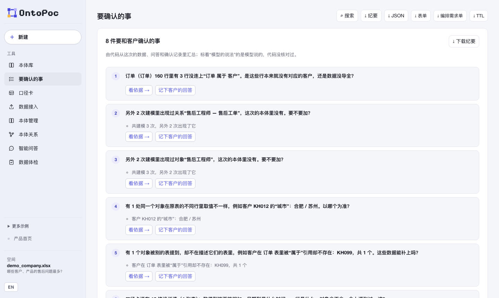
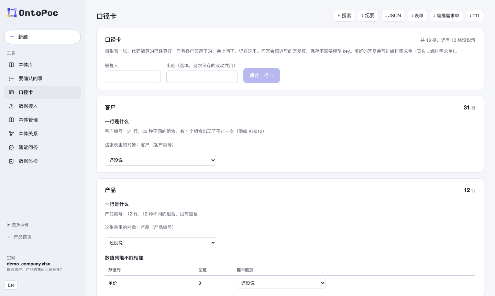
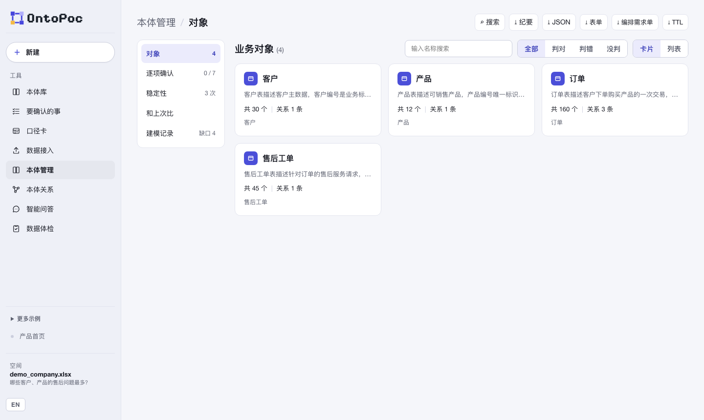
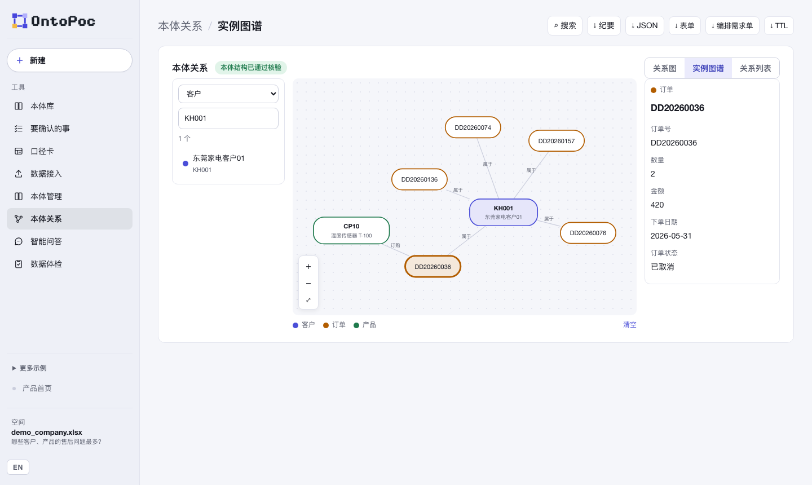
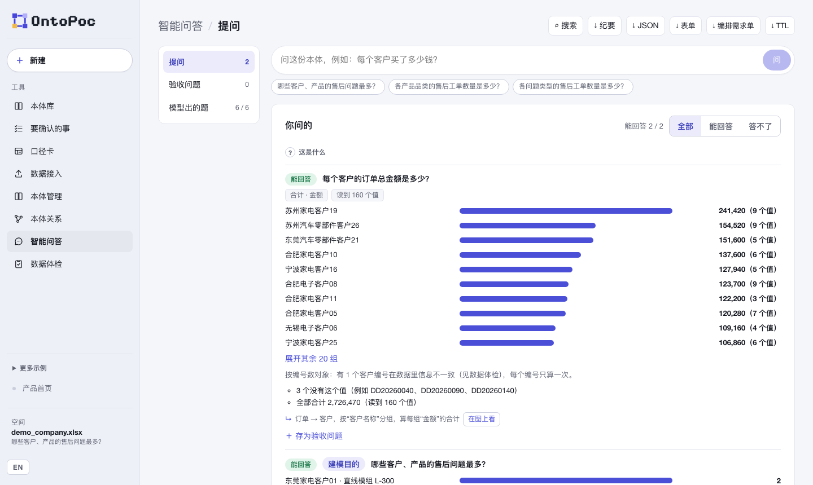
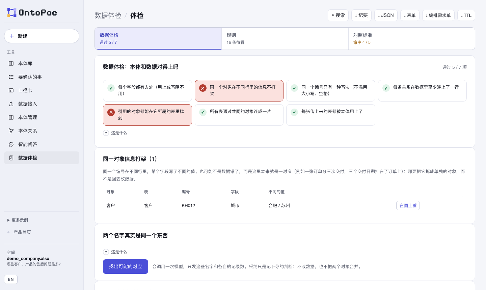

# The earlier screen organised around runs

Moved from the [README](../README.en.md). The team app is the main line now; this is the earlier screen organised around one run at a time (`legacy.html`).

This section is about the earlier screen (`legacy.html`): each upload is one run, kept in `output/ontology-runs/`.

## Overview

Upload a few business tables (Excel, CSV) or a process document, and OntoPoc drafts an ontology: which objects the business has, what tells each one apart, and how they relate. To draft, code first counts over every row (how many distinct values each column has, which columns differ on every row, which columns have values found in another column); the model drafts from the field names, up to 3 example values and these counts. Code then checks the draft for 14 kinds of error, for example whether a field exists, whether an identity field has values, whether a relation connects any rows, and sends it back if it fails, up to 3 rounds. It runs data quality checks and answers business questions from the data. A document can also be read as an organisation: units, roles, people and work steps, and who belongs to, works with or hands over to whom, each item with a quote from the text. You judge each part right or wrong; your judgement is kept, and the next upload of the same file, or a new version of it, is compared against it.

Some things the data cannot settle and only the client can. Code gathers them into one list, Items to confirm (要确认的事), each with its basis and a sentence you can ask the client directly. Each table also gets a definition card (口径卡) that says what one row is, what time a date refers to, and whether a number can be added up. You record the client's answers in the meeting, and the questions are then computed with those answers.

Every uploaded table is also stored in a local `workspace.sqlite`: one table per version, the row count checked on every import (rows in the file = rows stored + blank and title rows dropped), each check kept with its query and the rows it looked at, and each confirmation kept as a state with who confirmed it and on what. A definition a person confirmed (what status code 2 means, which row to keep for a repeated number, what counts as a valid order) becomes a named view that questions, pipelines and answer checks all read from one place, instead of relying on the model to remember it.

The result can be exported in the shape of a data platform's object form; as a pipeline requirements sheet (编排需求单) for whoever builds the data pipeline, and a one-page meeting note; or as W3C Turtle (OWL and SHACL). Some features are also MCP tools other agents can call (the newer definition and join features have none yet).

> **Early version.** It has been tried on public and synthetic data only (US federal procurement, Chicago city contracts, Northwind, BART transit, the Taiwan company registry, CMS hospitals and more). Nobody but the author has yet used it end to end on their own, and it has not been compared with doing the same thing directly in a general-purpose coding assistant. The page has been used on macOS only. Batch import has not been tested on any data platform. A single file, or several tables uploaded together, may total at most 10 MB; the model is reached through DeepSeek's hosted API or OpenRouter (any OpenAI-compatible endpoint can be configured), with no local-model option. See [Known issues](#known-issues) below and [KNOWN_ISSUES.en.md](KNOWN_ISSUES.en.md).

## Screenshots

Items to confirm (要确认的事): 8 items on the sample workbook, each with its basis and a sentence you can ask the client (the screenshot shows the earlier list; it is now one card at a time).

Definition cards (口径卡): code has already worked out which columns tell each table's rows apart; what one row is and whether a number can be added up are left for the client.

Ontology (本体管理): the 4 business objects built from the sample workbook; on the left, item-by-item confirmation (逐项确认), stability (稳定性), last-run comparison (和上次比) and build record (建模记录).

Instance graph (实例图谱): customer KH001 opened out to its orders, and one order to its product; on the right, the selected order's raw fields.

Questions (智能问答): the model writes the question as a query; code computes the numbers on the uploaded data and says how many values it read.

Data check (数据体检): on this sample, 5 of 7 checks pass; the 2 that fail are problems planted in the sample, with the objects involved listed below.

All screenshots come from the synthetic sample in the repository, `examples/company/demo_company.xlsx`, rendered off-screen by a headless browser.

## How it works

| Action | What the system does |
|---|---|
| Open the ontology library (本体库) in the left sidebar | Search and browse 12 Playground reference ontologies by domain, and see objects, properties and relations on a graph. You can also import `.rdf/.owl` files in RDF/XML format. This is for reading definitions only: import calls no model, and you must pick the file again after a refresh |
| Upload tables and write the question you want answered | Code first counts every row: how many distinct values each column has, which columns differ on every row, which columns point into another table. The model sees each column's name, up to 3 example values and these counts, and proposes objects, identity fields and relations; code checks 14 kinds of error and sends it back to redo, up to 3 rounds |
| Wait for the build | Builds the same file 3 times at once and marks where the 3 disagree, for you to decide; only objects and relations are compared, not properties; if your purpose asks a question, it is answered from the data too, ready to keep as an acceptance question |
| Open Items to confirm (要确认的事) | Code gathers what to confirm with the client from the data, the questions and the confirmation record, for example rows whose relations do not connect, objects with the same name but different numbers, and filters the model added by itself in a question. Each item has its basis and a sentence you can ask the client directly. Items come as a stack of cards: the basis, up to 3 example rows from the uploaded table and the check result, a progress line (items left, items decided), keys 1 to 4 to reply (confirm, wrong, not applicable, known exception with its reason, plus the item's own choices) and J / K to move; an item with choices of its own can also be answered in words alone; each reply keeps its own draft; the "left" count leaves out the card to fill in and the objects to judge, which can only be done elsewhere; an answer under 已定 can be taken back and changed with its words in the form, and so can the meanings of a code column, "not a code" and a repeat rule; once a newer version exists, answers and take-backs on the older one are refused. Each reply records who gave it and whether it was decided one by one or in bulk; "not applicable" and "known exception" are not asked again on the next upload unless the data they rest on changes: for a code meaning its values and their share of the rows, for a repeated number the numbers, for unmatched or mismatching rows their share, for the rest that can be counted (conflicting values, groups sharing a name, relations that did not appear often enough, questions that cannot be answered) whether the count has doubled or halved (by at least 5); for what has nothing to count (a model-reported data gap about one column, a column with no table to work it out from) the decision holds until the person takes it back. Only the one-click approval can record "bulk". Only what code can verify completely is listed to approve together: a relation whose two objects are judged right, whose every row connects, whose target table has no repeated numbers, and whose direction is either declared and holds in the data or undeclared but computed one-to-one or many-to-one (the list says which). After you have looked, approving records a bulk confirmation for those items only; what others signed and their versions stay as they were. The service works the list out again inside the write transaction and approves nothing if it changed. A code meaning is a person's reading of the data, which the data cannot prove, so it is never in the list and is confirmed one by one. Approved relations show under 已定 with who approved and "bulk". Columns whose name does not match their arithmetic are here too: a column called 交付天数P50 is worked out again from the rows in another table, and if it is really the mean, it becomes an item (rename it or keep it). Confirmed code meanings, repeated-number rules, named views and relations remember the data they were confirmed on; when a later upload moves it (say the status codes shift), the confirmation is marked "needs another look" (需要再看一眼) and is not used as confirmed until a person confirms it again |
| Open Data (数据接入) | Each table is checked for row count and key on import (empty numbers, repeated numbers), and the rows dropped are listed with the reason. Code finds columns that look like codes (status 1/2/3), each value with its row count and evidence, and you write what it means. A repeated number in the table that describes an object becomes an item to confirm: keep every row, keep the latest by a column, or call it a data error. Confirmed definitions generate named views (such as "valid orders" or "latest snapshot") listed with their SQL and row count; a definition that no longer holds is marked unavailable with the reason. Every relation is checked on the stored tables: how many rows connect, which keys do not (3 orders name KH099, which the customer table lacks), whether the described end repeats a key, and whether the declared cardinality holds |
| Join two tables on Data (数据接入) | Pick two tables (or views) and the join columns. Every node shows its rows in and out; when the join makes more rows than the left table, it names the keys that repeat on the right and the sums that would be counted twice. In the synthetic test tables, 160 orders left-joined to tickets become 169 rows |
| Open Definition cards (口径卡) | One per table: what one row is, what time a date column refers to, whether a numeric column can be added up. Code fills in what it can work out; only the cells the client can answer are left for the meeting. The answers you fill in are used when questions are computed, and are written into the pipeline requirements sheet |
| Open the data check (数据体检) | Code runs 7 checks on the data, e.g. whether one number carries conflicting details, whether every uploaded table is used. The relation check only requires each relation to connect at least one row; the page states how many rows connect |
| Ask a question (智能问答) | The model writes a structured query and code computes the answer on the data; each answer says "理解为…" (read as…): which confirmed definition the model used for the question, including its direction ("cancelled", "not cancelled"), and code checks that against the query that actually ran. One that is undeclared, unused or whose name matches nothing is refused with how it was read; when it cannot, it says whether the ontology lacks something, the data lacks it, or the question is beyond the query. An amount that needs a formula (unit price × quantity × (1 − discount)) is proposed by the model, tried by code on every row, and once you confirm it the question is recomputed and answered. If an answer carries a filter the model added by itself, the filter is listed separately and you can drop it and recompute. The model can also write a round of 6 questions on request |
| Look at a relation's binding | Shows the source table and the two end ID columns, e.g. `EmployeeId → ReportsTo`. An endpoint reference connects only to objects that exist and never writes a subordinate's attributes onto the superior. When verification fails, it shows where, why and what to change |
| Judge each part, rename, add what is missing | Saved as this file's reference ontology; the next upload is compared against it and prefilled |
| Fix up to 3 questions as acceptance questions (验收问题) | Every rerun computes them with the same query and tells you which changed |
| Adopt rules found in the data | Every rerun checks them and lists the objects that break them |
| Mark an uploaded file as a new version (新版本) | Last time's confirmations (including what you judged wrong), acceptance questions and rules carry over, with how many of each object came and went. An object the model proposes again after you judged it wrong is flagged on its own |
| Draft the object form | One model call drafts Chinese names, descriptions and display fields; what you edited is never overwritten by a redraft |
| Export the object forms: click "⤓ 表单" at the top right | One CSV per object, in the columns data platforms usually ask for when defining an object |
| Click "⤓ TTL" at the top right | Three Turtle files: `ontology.ttl` describes objects, fields, relations and identity fields in OWL; in `data.ttl` every object is named by its identity values, so the same object in two tables or two versions of a file has one name and merges; `shapes.ttl` writes adopted rules as SHACL for any validator. What you judged wrong is left out |
| Click "⤓ 编排需求单" (pipeline requirements sheet) at the top right | Downloads a zip (one Markdown file and one JSON file) for whoever builds the data pipeline: the requirements that the data check, the items to confirm, the definition card answers, the confirmed metrics and the adopted rules place on data preparation. Each line states its source (found in the data by code, the client's answer, or a person's confirmation). It calls no model and changes no data |
| Click "⤓ 纪要" (meeting note) at the top right, or press ⌘K | Meeting note: one page of Markdown with the items to confirm first, for use in the meeting. ⌘K: search the objects, fields, relations and tables of this run and jump to where they are |

The model only judges; loops and calculations are in code, with model calls chained at most 3 deep and each call tied to a judgement a person has to make. There are 6 agents, each with a definition card in [docs/AGENTS.md](AGENTS.md).

## Try it

Once installed (see [Quick start](../README.en.md#quick-start)), open `legacy.html` and try the synthetic sample in the repository:

| Action | Expected result |
|---|---|
| Without the modelling service, click "Open sample tables" (打开示例数据表) | A bundled result: 4 objects, 3 relations |
| Upload `examples/company/demo_company.xlsx` with "哪些客户的售后问题最多？" (which customers have the most after-sales problems?) as the purpose | After about half a minute to a minute, 4 objects: customer, product, order, after-sales ticket; data check 5 / 7 passed, the 2 that fail being the problems planted in the sample; in Questions (智能问答) › Ask (提问), this question is already answered from the data |
| Open Items to confirm (要确认的事) | In the built-in demo, 8 items to confirm with the client (the count changes with whether the three builds agree), including the planted problems: customer KH012 has different cities on two rows, and the orders refer to KH099, who is not in the customer table |
| In Questions (智能问答), ask "每个客户的订单总金额是多少？" (total order amount per customer) | Totals per customer, highest 241,420, from 160 values read |
| Relations (本体关系) → Instance graph (实例图谱), pick a customer | The customer and its orders as a graph; click an order to open its product |
| Click "⤓ 表单" at the top right | A zip: 4 object-form CSVs and an import note |

## Features

| Module | What is in it |
|---|---|
| Ontology library (本体库) | 12 Playground reference ontologies, browsed by domain, with objects and relations on a graph; import `.rdf/.owl` files in RDF/XML format |
| Items to confirm (要确认的事) | What to confirm with the client, a stack of cards with the basis, example rows and check result, answered with keys 1 to 4; the meeting note can be downloaded |
| Definition cards (口径卡) | One per table: what one row is, what time a date column refers to, whether a numeric column can be added up, whether the objects are all there; records who answered and the source |
| Data (数据接入) | Each uploaded table: rows, skipped title lines, each column's type, length and fill; the import row-count and key checks, code meanings, repeated-number rules, named views, two-table join and relation checks; when tables are left unconnected, the column that would connect them |
| Ontology (本体管理) | Object cards (search, filter by your verdict, cards or list); each object's page: overview, fields (the object form), rows (paged, CSV download), confirmation; plus item-by-item confirmation, stability, last-run comparison (和上次比), new version (新版本) and build record |
| Relations (本体关系) | A graph that lays itself out (drag, zoom), the instance graph, the relation list; relations code sees in the data but the ontology lacks are drawn as dashed suggestions |
| Organisation (组织架构) | Choose "组织架构" when uploading a public study: the organisation tree, collaboration and handover (the arrow says what is handed over), a role table, periods, and what the material does not state; export Mermaid organisation charts, one chart per year range |
| Questions (智能问答) | Ask, acceptance questions, the model's questions (filter by answered) |
| Data check (数据体检) | 7 checks, rules (规则), comparison with a reference ontology (对照标准) |

Under "More examples" (更多示例) in the sidebar there are two more example uses of the same method: vehicle recall scope (NHTSA public data, no local service needed), and product and lot matching for food recall event 95876 (openFDA, which needs a separate local recall service started). See [docs/RECALL_EXAMPLE.md](RECALL_EXAMPLE.md). OntoPoc is not affiliated with NHTSA or any carmaker, and its candidates are not defect findings.

## What the model sees

Moved from the README's Privacy section; what the team app sends is in the README.

- Sent to the model by the earlier screen (DeepSeek, or a model on OpenRouter): the modelling purpose; for each table its row count, each column's name, up to 3 example values, the counts code took (values present, distinct values, whether all differ), the columns or column pairs that differ on every row, and likely links (including into the same table); every value of a category-like column; when writing questions, every value of columns with at most 12 distinct values, and any question you type in 智能问答 (Q&A) as written; when you click "起草" (draft) for field descriptions, each field's type and maximum length; when you click "找出可能的对应" (find possible matches), for objects identified by a single field with 2 to 200 values, all identity values and how many rows each appears in; for documents, the text, at most 12 chunks per upload. The upload page shows exactly what will be sent for modelling, column by column.

## Known issues

Issues that belong only to the earlier screen, moved from [KNOWN_ISSUES.en.md](KNOWN_ISSUES.en.md); issues it shares with the team app are still there.

- **The model builds differently each time.** Three builds of one file often differ, now mainly in the relations: in one measurement on Northwind on 10-28 (8 kinds of object, 7 relations), 4 relations differed across the 3 builds, nearly all because the same relation ran the other way (order → customer / customer → order). The page marks where they disagree for you to decide.
- **A new version may come with a different way of telling objects apart.** Once, Chicago's contracts went from "number + revision" to number alone; then only counts can be compared, not objects one by one, and the page says so ("识别方式已变更", identification changed).
- **Batch import is untested.** The exported form columns follow what data platforms usually ask for; import format, key rules and how relations are expressed differ by platform and have not been tested on any, so no relation table is exported.
- **Turtle export is checked only by reading it back with rdflib and pyshacl.** It has not been loaded into Protégé or a graph database.
